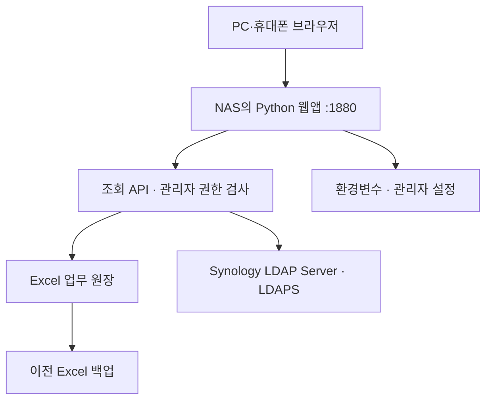

# BUMJIN IT 자산관리 — 운영·개발 인수인계서

PC·모니터·소프트웨어·전산 유지보수 정보를 Excel 원장과 연동해 관리하는 사내 웹 프로그램입니다. QR 라벨로 자산을 조회하고, 관리자는 사용자 배정·확인·수거·수정을 처리합니다. Synology LDAP Server의 계정 조회·직원 로그인·부서 속성 수정도 지원합니다.

**문서 기준일: 2026-10-16.** NAS에서 사용하는 Python 백엔드와 같은 저장소의 최신 코드를 기준으로 작성했습니다. 실제 운영 NAS에 이 코드가 배포됐는지는 별도로 확인해야 합니다. 이 문서는 설치·운영 방법을 설명하며, 운영 장비에 자동으로 설정을 적용하지 않습니다.

> 후임자가 먼저 알아야 할 세 가지
>
> 1. 업무 데이터의 원본은 **현재 앱에서 사용하는 XLSX 파일**입니다. 원래 배포받은 빈 양식이나 과거 원본과 구분하세요.
> 2. Docker 이미지는 코드, NAS의 `data` 폴더는 운영 데이터입니다. **업데이트할 때 data를 새 소스로 덮어쓰지 않습니다.**
> 3. 관리자·LDAP 설정은 `admin_settings.json`, 접속 주소 등 실행 설정은 환경변수에 있습니다. **엑셀 하나로 업무 데이터는 복구할 수 있지만 실행 환경 전체가 복구되는 것은 아닙니다.**

## 목차

1. [후임자 첫 확인 순서](#1-후임자-첫-확인-순서)
2. [기능과 권한](#2-기능과-권한)
3. [시스템 구조와 데이터 흐름](#3-시스템-구조와-데이터-흐름)
4. [파일과 소스 역할](#4-파일과-소스-역할)
5. [Excel 데이터 구조](#5-excel-데이터-구조)
6. [설정과 비밀번호](#6-설정과-비밀번호)
7. [Synology NAS 설치와 실행](#7-synology-nas-설치와-실행)
8. [업데이트와 이전 버전 복귀](#8-업데이트와-이전-버전-복귀)
9. [백업과 데이터 복구](#9-백업과-데이터-복구)
10. [Windows 로컬 테스트](#10-windows-로컬-테스트)
11. [LDAP 연동과 조직도 관리](#11-ldap-연동과-조직도-관리)
12. [실무 작업 절차](#12-실무-작업-절차)
13. [QR 주소·스캔·인쇄](#13-qr-주소스캔인쇄)
14. [장애 대응](#14-장애-대응)
15. [개발자가 알아야 할 구현](#15-개발자가-알아야-할-구현)
16. [검증과 현재 한계](#16-검증과-현재-한계)
17. [최종 인수인계 확인표](#17-최종-인수인계-확인표)

## 1. 후임자 첫 확인 순서

### 1.1 처음 15분 동안 확인할 것

1. 실제 앱 주소와 `/login`을 열어 접속되는지 확인합니다.
2. 관리자 계정을 인계받아 자산 수량, 사용자 목록, 조직도를 확인합니다.
3. NAS에서 컨테이너 이름·이미지·포트·볼륨을 확인합니다.
4. **실제로 연결된 Excel 파일 위치와 최종 수정일**을 확인합니다.
5. 기존 QR 한 장을 휴대폰으로 열고, 앱의 같은 자산과 관리번호가 일치하는지 확인합니다.
6. 아래 운영 환경표를 사내 문서에 작성합니다. 비밀번호 원문은 표에 적지 않습니다.

### 1.2 사내에서 별도 보관할 운영 환경표

이 저장소의 예시 주소·계정은 자리표시자입니다. 실제 내부 주소·계정·담당자 정보는 사내 접근 제한 문서에 기록하세요.

| 인계 항목 | 기록할 내용 |
| --- | --- |
| 운영 담당자 / 대체 담당자 | 이름, 연락 경로, NAS 접근 권한 |
| NAS 모델 / DSM 버전 / Docker 패키지 | 실제 설치 버전, SSH 포트 |
| 앱 고정 주소 | QR에 들어 있는 프로토콜·호스트·포트 |
| 프로젝트 경로 | 예: `/volume2/docker/Bumjin_ITAM-main` |
| 컨테이너 이름 / 운영 이미지 | 예: `bumjin-itam`, 이미지 ID 또는 배포 태그 |
| 배포한 Git 커밋 / 배포일 | ZIP 파일명도 함께 기록 |
| 실행 방식 | `docker run` 또는 Compose 중 실제 사용 방식 |
| 데이터 경로 / ASSET_FILE | NAS 경로와 컨테이너 경로를 각각 기록 |
| 환경설정 파일 | 직접 실행은 `.env.runtime`, Compose는 `.env` |
| 관리자 비밀번호 인계 위치 | 사내 비밀번호 관리 도구의 항목 위치 |
| LDAP 접속 정보 | 호스트, 포트, Base DN, Bind DN, 실제 속성명 |
| LDAP 인증서 | CA 파일 경로, 만료일, 교체 담당자 |
| 데이터 소유 UID/GID | 컨테이너 실행 사용자와 폴더 권한 |
| 백업 / 복구 시험 | 보관 위치, 주기, 최근 복구 시험일 |
| HTTPS 사용 시 | DNS, 역방향 프록시 규칙, 인증서 갱신 담당자 |

### 1.3 운영 상태 확인 명령

NAS SSH 접속 후 실행합니다. 명령은 컨테이너 환경변수의 비밀번호를 출력하지 않습니다.

```bash
sudo docker ps -a --filter name=bumjin-itam
sudo docker inspect bumjin-itam --format 'Status={{.State.Status}} ExitCode={{.State.ExitCode}} Error={{.State.Error}}'
sudo docker inspect bumjin-itam --format '{{.Image}}'
sudo docker inspect bumjin-itam --format '{{range .Mounts}}{{.Source}} -> {{.Destination}}{{println}}{{end}}'
sudo docker port bumjin-itam
sudo docker logs --tail 50 --timestamps bumjin-itam
```

`Up`만으로 웹앱이 정상이라고 판단하지 않습니다. 다음 GET 요청도 확인하세요. 이 예시는 NAS의 기본 HTTP 1880 포트 기준입니다.

```bash
curl -s -o /dev/null -w '%{http_code}\n' http://127.0.0.1:1880/login
```

로그인 화면은 일반적으로 `200`입니다. `000`은 접속 실패, `403`은 게이트웨이 등 접근 설정 확인이 필요합니다. `HEAD` 요청은 현재 앱에서 별도로 지원하지 않으므로 `curl -I` 대신 위 GET 명령을 사용합니다.

## 2. 기능과 권한

### 2.1 지원 기능

- BJC·BJE·BJM 자산 조회, 검색, 법인·상태·장비 구분 필터, 대시보드 시각화
- PC·모니터 등록·수정, 법인/장비 구분에 따른 자산코드 자동 채번
- 사용자 확인, 사용자 변경, 수거/반납, 변경 이력
- Office·한글·SAP·백신·OfficeKeeper·Docuone 등 원장에 기록된 SW 정보 관리
- 유지보수 계약·비용·기간 및 원본의 추가 SW 대장 조회
- Excel 사업부/부서 기반 초기 조직도, 조직 생성·편집, LDAP 사용자 부서 배정
- 이름 기반 자산을 LDAP 계정에 연결하고 선택한 조직 경로를 LDAP 부서에 저장
- 자산별 QR, 40×40mm 라벨 및 Formtec QRP-3990 A4 PDF 출력
- 관리자 로그인, LDAP 직원 조회 전용 로그인, 로그인 없는 QR 단건 조회

**SW 관리는 Excel에 입력된 사용 여부/버전 관리입니다. PC에 설치된 프로그램을 자동 수집하거나 라이선스 적법성을 자동 판정하지 않습니다.**

### 2.2 권한표

| 기능 | 로그인 없음 | LDAP 직원 | 로컬 관리자 `admin` |
| --- | --- | --- | --- |
| QR 주소를 가진 자산 한 건 조회 | 가능 | 가능 | 가능 |
| 조회용 자산 목록·검색·스캔 | 불가 | 가능 | 가능 |
| 자산 현황·관리 화면 | 불가 | 조회용 목록으로 제공 | 가능 |
| 사용자 확인·변경·수거·수정 | 불가 | 불가 | 가능 |
| 사용자/조직 관리·LDAP 부서 수정 | 불가 | 불가 | 가능 |
| 유지보수 관리·전체 Excel 다운로드·라벨 출력 | 불가 | 불가 | 가능 |
| 관리자 비밀번호·LDAP 설정 변경 | 불가 | 불가 | 가능 |

직원에게 관리 버튼을 숨기는 것에 더해 **백엔드가 관리 API 요청을 거부**합니다. LDAP 계정 이름이나 소속 그룹으로 관리자 권한을 자동 부여하지 않습니다. 현재 개인별 관리자 계정 기능은 없으며 `admin`이 로컬 관리자용 예약 ID입니다.

### 2.3 QR 조회 화면에 제공하는 정보

현재 사용자 이름·부서, 자산관리번호, 법인, 장비 구분·모델·주요 사양, 구입/제조일, 상태를 제공합니다. 이메일·LDAP 계정 ID/DN·고유 ID·일련번호·비고·SW 정보·변경 이력·전체 원장은 조회용 응답에서 제외합니다.

로그인 없이도 QR 주소를 아는 사람은 이 정보에 접근할 수 있습니다. 사내망 운영을 기준으로 하며, 공개 인터넷에 노출할 경우에는 공개 범위를 별도로 검토해야 합니다.

## 3. 시스템 구조와 데이터 흐름

### 3.1 구성



- 프런트엔드: HTML/CSS/일반 JavaScript. NAS 실행에 React·Node.js 빌드는 필요하지 않습니다.
- 백엔드: Python 3.11 기반 Docker 이미지, WSGI `wsgiref.simple_server`.
- 업무 저장소: `openpyxl`로 읽고 쓰는 XLSX 한 파일. 별도 DB 서버가 없습니다.
- LDAP: `ldap3`, 현재 웹앱은 **LDAPS**를 사용합니다.
- QR/PDF: `reportlab`. QR 이미지 인식은 브라우저 내 `jsQR`.
- 실행 단위: **웹앱 프로세스 하나 / 같은 Excel에 쓰는 컨테이너 하나**를 기준으로 합니다.

### 3.2 주요 데이터 흐름

| 작업 | 읽는 곳 | 저장되는 곳 / 외부 영향 |
| --- | --- | --- |
| 자산 조회 | Excel 원장 및 앱 사용자 시트 | 조회만 수행 |
| 자산 등록·수정·수거 | Excel의 현재 값·revision | 원본 자산 시트, `앱_이력`, 이전 XLSX 백업 |
| LDAP 사용자·조직 가져오기 | 실제 LDAP | Excel의 LDAP 사용자·OU 캐시 및 조직 경로 |
| 조직도 생성 | Excel 조직 시트 | Excel에만 저장. LDAP OU를 만들지 않음 |
| LDAP 부서 배정 | 선택 계정, 실제 LDAP의 현재 값 | LDAP 부서 속성, Excel 캐시·감사 이력, JSONL 기록 |
| 이름 기반 사용자 계정 매핑 | 선택한 원장 자산, LDAP 사용자 캐시 | 먼저 Excel 계정 매핑, 이어서 LDAP 부서 저장 |
| 직원 로그인 | 실제 LDAP에 조회 및 사용자 비밀번호 Bind | 서버 메모리의 조회 전용 세션. 비밀번호 저장 안 함 |
| 관리자 비밀번호 변경 | 현재 관리자 설정 | `admin_settings.json`의 해시·salt |

### 3.3 단순 조회와 관리 주소

- `/a/자산UUID`: **항상 조회 전용**. 관리자가 로그인해 있어도 직접 QR 주소는 조회 화면입니다.
- `/manage/a/자산UUID`: 관리자용 상세. 미로그인은 로그인 화면, 직원 세션은 접근 거부입니다.
- 관리자가 앱 메뉴의 QR 스캔을 사용하면 관리 주소로 이동합니다.
- 조회 화면에서 관리자 로그인을 선택하면 로그인 후 같은 자산의 관리 주소로 돌아갑니다.
- LDAP 직원으로 로그인하면 같은 자산의 조회 주소로 돌아갑니다.

## 4. 파일과 소스 역할

### 4.1 NAS 운영 파일

| 경로 | 역할 | 인계·백업 여부 |
| --- | --- | --- |
| `Dockerfile` | Python 이미지 빌드, backend/public 복사, 실행 명령 | 소스 버전과 함께 보관 |
| `docker-compose.yml` | Compose 설치용 컨테이너 설정 | 실제 사용 시 설정 보관 |
| `.env.runtime` | `docker run --env-file`에 명시적으로 전달하는 운영 환경변수 | 별도 안전 보관 |
| `.env` | Compose가 읽는 `ITAM_*` 변수 파일 | Compose 사용 시 안전 보관 |
| `data/Bumjin_IT자산관리대장.xlsx` | 업무 원본, 관리 시트, UUID, 사용자 매핑 | **최우선** |
| `data/admin_settings.json` | 관리자 비밀번호 해시·salt, LDAP 연결 설정 | 전체 환경 복구 시 필요 |
| `data/ldap_department_audit.jsonl` | LDAP 부서 쓰기 pending/성공/실패/확인 필요 기록 | LDAP 장애 추적 시 필요 |
| `data/backups/*.xlsx` | 저장 직전 Excel 사본 | 복구 후보, 용량 관리 필요 |
| `data/*.app.lock` | 앱 프로세스 중복 실행 방지 표식 | 업무 데이터 아님. 임의 삭제 금지 |
| `certs/*.pem` | LDAPS 서버 검증에 쓰는 공개 CA/인증서 | 운영 인증서 정책에 따라 보관 |

NAS의 `data`가 컨테이너 `/data`, NAS의 `certs`가 컨테이너 `/certs`로 연결됩니다. `/data`는 읽기·쓰기, `/certs`는 읽기 전용입니다.

### 4.2 개발 소스

| 파일 | 수정할 때 보는 기능 |
| --- | --- |
| `backend/app.py` | HTTP 라우팅, 권한 검사, Excel 조회/저장, 자산·매핑·유지보수, QR SVG |
| `backend/auth_service.py` | 세션/쿠키/CSRF, 관리자·LDAP 직원 로그인, 만료·로그아웃 |
| `backend/admin_service.py` | 관리자 설정 파일, 비밀번호 해시, LDAPS 연결·사용자 가져오기 |
| `backend/organization_service.py` | Excel 조직 트리, 최초 가져오기, 자산-조직 연결, LDAP 부서 수정·감사 |
| `backend/label_pdf.py` | 40mm/A4 PDF 라벨 배치, 로고, 위치 보정 |
| `backend/start.ps1` | Windows 가상환경 생성·실행, 초기 관리자 비밀번호 입력 |
| `backend/requirements.txt` | Python 라이브러리 의존성 |
| `public/index.html` | 관리자 화면 전체. CSS와 JavaScript가 같은 파일에 포함됨 |
| `public/asset-view.html` | QR 단건 조회, 직원 자산 목록·검색 화면 |
| `public/login.html` | 회사 로고 로그인 화면 |
| `public/qr-scanner.js` | 실시간 카메라, 사진 QR 인식, 주소 입력, 화면 이동 |
| `public/vendor/jsQR.js` | 포함된 jsQR 1.4.0. 외부 CDN 불필요 |
| `public/vendor/jsQR-LICENSE.txt` | 위 라이브러리 라이선스 |
| `public/qr-label-logo.svg` | 기존 회사 로고를 포함한 QR·로그인 로고 소스 |
| `backend/test_*.py` | 자산·로그인·권한·조직·LDAP 모의 연결 자동 테스트 |
| `backend/sync_ldap.py` | 초기 개발 때 사용한 별도 CLI 가져오기. 현재 운영 권장 경로 아님 |
| `api/`, `scripts/build.mjs`, `vercel.json`, `package.json` | 과거 Vercel 프런트/브리지 구성. NAS 런타임과 별개 |

`sync_ldap.py`는 사용자 4열을 가져오는 과거 방식입니다. 현재 7열 사용자·부서·설명을 온전히 유지하는 웹 관리자 가져오기와 다릅니다. 정기 작업으로 등록하거나 현재 운영 시트에 무심코 실행하지 마세요. 운영에서는 `/admin`의 가져오기를 사용합니다.

## 5. Excel 데이터 구조

### 5.1 원본 자산 시트

프로그램은 시트 이름·열 위치를 코드로 참조합니다. 자산 데이터는 **6행부터**, 앱용 숨김 열의 제목은 **5행**입니다.

| 법인 | PC 시트 | 모니터 시트 |
| --- | --- | --- |
| BJM | `3.BJM PC 현황` | `3_1.BJM 모니터 현황` |
| BJE | `4.BJE PC 현황` | `4_1.BJE 모니터 현황` |
| BJC | `5.BJC PC 현황` | `5_1.BJC 모니터 현황` |

공통 기본 열:

| 열 | PC | 모니터 |
| --- | --- | --- |
| B | 자산관리번호 | 자산관리번호 |
| C | 부서 | 부서 |
| D | 사용자 이름 | 사용자 이름 |
| E | 장비 유형 | 화면 크기 |
| F | 제조사 | 모델 |
| G | 모델 | 일련번호 |
| H | 일련번호 | 등급용 열 |
| I | CPU | 제조일자 |
| J | 비트 정보 | 비고 |
| K | RAM | 상태 |
| L / M / N | SSD / HDD / 그래픽 | PC와 다름 |
| O / P | OS / OS Edition | PC와 다름 |
| Q / R | Office / 한글 | PC와 다름 |
| AZ | **APP_ASSET_ID — 자산 UUID** | 동일 |
| BA | **APP_LDAP_UID — 매핑 계정 ID** | 동일 |

PC 시트별 추가 열:

| 법인 | 추가 SW | 날짜 | 상태 | 등급 수식 | 비고 |
| --- | --- | --- | --- | --- | --- |
| BJM | S=OfficeKeeper, T=백신 | W | X | U | V |
| BJE | S=SAP, T=백신, U=Docuone, W=기타 | Y | Z | V | X |
| BJC | S=SAP, T=백신, U=Docuone, W=기타 | Y | Z | V | X |

모니터는 세 법인 모두 날짜 I, 상태 K, 등급 H, 비고 J를 사용합니다. 화면의 노후 등급은 날짜 기준으로 다시 계산합니다. A=3년 미만, B=3년 이상, C=5년 이상, D=10년 이상이며 날짜가 없거나 해석되지 않으면 미확인입니다.

열을 추가하더라도 기존 열을 이동하면 매핑이 깨질 수 있습니다. 원본 구조 변경 시 `CONFIG`, `BASE`, `MONITOR_BASE`, `SOFTWARE_EXTRA`와 관련 테스트를 함께 수정해야 합니다.

### 5.2 앱 관리 시트

| 시트 | 저장 내용 / 중요한 키 |
| --- | --- |
| `앱_이력` | 시각, 자산 UUID, 작업 유형, 변경 전 JSON, 변경 후 JSON, 작업자 계정 |
| `앱_LDAP사용자` | A=uid, B=표시이름, C=이메일, D=디렉터리 고유 ID, E=부서 경로, F=DN, G=설명에서 읽은 직원 이름 |
| `앱_LDAP조직` | LDAP에서 조회한 실제 OU 이름·DN |
| `앱_조직` | 로컬 조직 ID, 조직명, 상위 조직 ID |
| `앱_자산조직` | 자산 UUID → 로컬 조직 ID 연결 |
| `앱_조직가져오기` | 초기 Excel 조직 가져오기 완료 표식 `EXCEL_ORG_IMPORT_V1`, 가져온 시각 |
| `앱_조직변경이력` | LDAP 부서 변경 시각·계정·고유 ID·이전/이후 경로·결과·배치 ID |
| `앱_유지보수` | 앱에서 추가한 유지보수 계약 |

시트가 모두 처음부터 있는 것은 아닙니다. 초기화 또는 해당 기능 사용 시 생성합니다. **기존 앱 시트나 AZ/BA 숨김 열을 삭제하지 마세요.**

### 5.3 유지보수 원본

- 기본 시트: `2.전산 유지보수`.
- 기존 계약 범위: 3~17행. 원본 병합 셀은 계약 그룹이 공유하는 정보로 읽습니다.
- B=업체, C=서비스, D=수량, E=법인, F=기간, G/H/I=2024/2025/2026 비용, J=연락 정보, L=비고, M=종료일, N=시작일.
- 18행 이후의 `◎`로 시작하는 제목을 추가 SW 대장 구분으로 읽습니다.
- 새 계약은 기존 원본 아래를 무조건 늘리지 않고 `앱_유지보수`에 추가합니다.
- 비용 연도는 현재 코드에 고정돼 있습니다. 다음 연도 운영 시 `MAINT_FIELDS`와 화면을 확인해야 합니다.

### 5.4 반드시 구분할 ID

| 값 | 역할 | 변경 시 영향 |
| --- | --- | --- |
| 자산관리번호 | 사람이 보는 코드. 예: `BJE-D-001` | 번호만 바꿔도 UUID를 유지하면 QR 연결 유지 |
| 자산 UUID | 실제 자산 내부 키, QR URL의 값 | 바뀌면 기존 QR이 다른/없는 자산을 가리킴 |
| LDAP uid | 계정 ID, 자산의 BA열에 기록 | 계정 재사용·변경 시 수동 검토 필요 |
| LDAP 디렉터리 ID | 보통 entryUUID 등 안정적인 계정 식별자 | 같은 uid의 고유 ID가 바뀌면 동기화가 차단됨 |
| 로컬 조직 ID | 조직 트리 내부 키 | 이름/상위 변경 후에도 자산 링크 유지 |

## 6. 설정과 비밀번호

### 6.1 환경변수

| 변수 | 의미 / 기본값 |
| --- | --- |
| `ASSET_FILE` | 원장 전체 경로. NAS는 `/data/Bumjin_IT자산관리대장.xlsx`를 **명시** |
| `HOST` | 수신 인터페이스. Docker는 `0.0.0.0`, Python 직접 실행 기본은 `127.0.0.1` |
| `PORT` | 앱 포트. 기본 `1880` |
| `PUBLIC_BASE_URL` | QR에 인코딩할 실제 앱 주소. 로그인 Secure 쿠키 판단에도 사용 |
| `APP_PASSWORD` | 저장된 관리자 해시가 없을 때 사용하는 초기 관리자 비밀번호. 12자 이상 |
| `LDAP_BIND_PASSWORD` | 선택 사항. 설정 파일에 저장하지 않는 LDAP 조회/수정용 비밀번호를 실행 환경에서 제공 |
| `BACKEND_GATEWAY_TOKEN` | 과거 브리지 구성용. NAS 브라우저 직접 접속 구성에서는 설정하지 않음 |
| `TZ` | Docker 시간대. 운영 예시 `Asia/Seoul` |
| `LABEL_FONT` | PDF 자산코드 글꼴의 서버 파일 경로. 선택 사항 |

`BACKEND_GATEWAY_TOKEN`을 설정하면 공개 QR·로그인 요청까지 게이트웨이 헤더가 필요합니다. NAS 직접 접속에서 임의로 넣으면 전체 접속이 막힐 수 있습니다.

`PUBLIC_BASE_URL`에 `127.0.0.1`을 넣으면 휴대폰에서 QR을 열 때 휴대폰 자신의 루프백으로 접속합니다. 실제 NAS 주소 또는 고정 앱 도메인을 사용하세요. HTTPS 주소를 설정하면 쿠키도 Secure로 발급하므로 사용자는 그 HTTPS 주소로 접속해야 합니다.

### 6.2 세 가지 설정 경로를 혼동하지 않기

| 실행 방식 | 설정 파일과 로딩 방식 |
| --- | --- |
| NAS `docker run` | `.env.runtime`을 `--env-file`로 전달. `ASSET_FILE`, `APP_PASSWORD` 등 직접 변수명 사용 |
| NAS Compose | `.nas.env.example`을 `.env`로 복사. `ITAM_PUBLIC_BASE_URL`, `ITAM_ADMIN_PASSWORD`, `ITAM_UID`, `ITAM_GID`를 Compose가 직접 변수명으로 변환 |
| Windows/Python 직접 실행 | 현재 셸의 환경변수 사용. `.env` 파일을 자동으로 읽지 않음 |

`backend/.env.example`의 `LDAP_*_ATTRIBUTE` 등은 과거 CLI 가져오기용 항목도 포함합니다. 현재 웹앱의 LDAP 호스트·Base DN·속성명은 **관리자 화면 → admin_settings.json**으로 관리합니다. `LDAP_BIND_PASSWORD` 외의 과거 LDAP 환경변수만 바꿔도 웹 관리자 설정이 바뀌지는 않습니다.

### 6.3 비밀번호와 세션

- 관리자 비밀번호를 웹에서 변경하면 `admin_settings.json`에 PBKDF2-SHA256 해시·salt가 저장되고, 이 값이 `APP_PASSWORD`보다 우선합니다.
- `.env.runtime`의 `APP_PASSWORD`를 바꾸는 것만으로 이미 변경한 관리자 비밀번호가 초기화되지 않습니다.
- 관리자 화면의 Bind 비밀번호는 메모리에 보관합니다. 저장 후 입력창이 비어도 정상이며 **서버 재시작 후에는 다시 입력**해야 합니다.
- `LDAP_BIND_PASSWORD`를 실행 환경에 제공하면 재시작 후에도 사용합니다. 환경설정 파일 자체는 비밀정보로 관리합니다.
- 로그인 세션은 서버 메모리에 최대 8시간 유지됩니다. 재시작 시 모두 로그아웃되며, 관리자 비밀번호 변경 시 기존 세션도 무효화됩니다.
- 쿠키는 HttpOnly·SameSite=Lax이며 HTTPS 구성에서는 Secure입니다. 브라우저 저장소에 비밀번호를 보관하지 않습니다.
- 같은 접속 주소에서 5분 내 로그인 실패가 8회 누적되면 일시 제한합니다. 사내 프록시를 쓰면 여러 직원이 같은 접속 주소로 보일 수 있습니다.

## 7. Synology NAS 설치와 실행

### 7.1 운영 방식 선택

DSM의 패키지 이름은 버전에 따라 **Docker** 또는 **Container Manager**일 수 있습니다. SSH에서 Docker CLI를 사용하는 아래 방법은 GUI 메뉴 이름에 의존하지 않습니다. Docker가 실행 중이고 해당 NAS에서 Python 이미지 실행이 가능해야 합니다.

새 설치 전에 최신 GitHub ZIP을 내려받아 프로젝트 폴더에 압축을 풉니다. 폴더 안에 같은 이름의 폴더가 한 단계 더 생기지 않았는지 확인하세요. `Dockerfile`, `backend`, `public`이 같은 루트에 있어야 합니다.

명령은 같은 SSH 세션에서 순서대로 실행하고, 각 단계가 성공한 뒤 다음으로 진행합니다. 연결을 종료하면 `ITAM_RELEASE_ID` 같은 셸 변수도 사라지므로 업데이트 중 사용한 백업 경로와 컨테이너 이름을 기록하세요.

### 7.2 Windows CMD에서 NAS 접속

Windows + R → `cmd` → Enter 후 실행합니다. 대문자 자리표시자는 실제 값으로 교체합니다.

```cmd
ssh YOUR_NAS_ACCOUNT@YOUR_NAS_IP
```

SSH가 기본 22가 아닌 경우:

```cmd
ssh -p YOUR_SSH_PORT YOUR_NAS_ACCOUNT@YOUR_NAS_IP
```

처음 접속할 때 서버 지문을 확인하고 승인합니다. 비밀번호를 입력해도 화면에 글자가 표시되지 않습니다. SSH 연결이 거부되면 DSM의 터미널 설정, SSH 포트, 방화벽, 사용자 권한부터 확인합니다.

### 7.3 파일 배치와 권한

이 문서의 NAS 예시 프로젝트 경로는 다음과 같습니다. 실제 경로가 다르면 이후 명령도 모두 변경합니다.

```bash
cd /volume2/docker/Bumjin_ITAM-main
mkdir -p data certs
ls -l Dockerfile backend/app.py public/index.html
id
```

File Station으로 기존 앱용 Excel을 다음에 넣습니다.

```text
/volume2/docker/Bumjin_ITAM-main/data/Bumjin_IT자산관리대장.xlsx
```

Docker는 이 파일을 `/data/Bumjin_IT자산관리대장.xlsx`로 읽습니다. NAS 운영 원장을 `backend/data`와 혼동하지 마세요. 로컬 Windows 기본 위치만 `backend/data`입니다.

기존 설정을 유지하려면 `admin_settings.json`도 NAS의 `data`에 옮깁니다. CA 인증서는 `certs`에 배치하고 앱에는 `/certs/파일명.pem`으로 입력합니다. 앱의 LDAP 클라이언트 연결에는 NAS 서버의 인증서 개인키가 필요하지 않습니다.

컨테이너 실행 UID/GID는 `id`로 확인한 NAS 계정과 맞춥니다. 이 계정이 data·Excel·설정 파일을 읽고 쓸 수 있고 certs를 읽을 수 있어야 합니다. 권한 문제를 해결하려고 모든 파일을 무조건 `777`로 바꾸지 않습니다.

### 7.4 직접 실행용 `.env.runtime`

프로젝트 루트에 텍스트 파일 `.env.runtime`을 만들고 다음 항목을 채웁니다. **아래 비밀번호·주소는 예시이며 반드시 교체**합니다. 파일 자체의 읽기 권한을 제한하고 GitHub에 올리지 않습니다.

```dotenv
HOST=0.0.0.0
PORT=1880
ASSET_FILE=/data/Bumjin_IT자산관리대장.xlsx
PUBLIC_BASE_URL=http://YOUR_NAS_IP:1880
APP_PASSWORD=CHANGE_TO_A_UNIQUE_12_PLUS_CHARACTER_PASSWORD
TZ=Asia/Seoul
```

LDAP Bind 비밀번호를 재시작 후에도 사용하려면 선택적으로 `LDAP_BIND_PASSWORD`를 같은 파일에 추가합니다. 파일에는 `export`나 `$env:` 접두어를 넣지 않습니다. `KEY=VALUE` 형식으로 작성합니다.

존재 여부만 확인하고 비밀번호가 포함된 전체 내용을 채팅이나 티켓에 붙여넣지 마세요.

```bash
ls -l .env.runtime data/Bumjin_IT자산관리대장.xlsx
```

### 7.5 이미지 빌드

```bash
sudo docker build -t bumjin-itam:latest .
```

마지막 `.`은 현재 프로젝트를 빌드 대상으로 지정하는 인자입니다. 소스 디렉터리에 실제 업무용 Excel의 불필요한 사본을 남기지 마세요. Dockerfile은 `backend` 전체를 이미지에 복사하므로 운영 원장은 루트의 data로 분리합니다.

빌드에는 Python 기본 이미지와 라이브러리 다운로드를 위한 인터넷 연결이 필요합니다. 빌드 실패 시 기존 컨테이너를 먼저 삭제하지 않습니다.

### 7.6 새 컨테이너 생성

**같은 이름의 컨테이너가 없는 새 설치에서 실행**합니다. 기존 컨테이너 업데이트는 8절을 따르세요.

LDAP 호스트를 사내 DNS에서 정상 해석할 수 있으면 다음 명령을 그대로 사용합니다.

```bash
sudo docker run -d \
  --name bumjin-itam \
  --restart unless-stopped \
  --user "$(id -u):$(id -g)" \
  --env-file "$PWD/.env.runtime" \
  -p 1880:1880 \
  -v "$PWD/data:/data" \
  -v "$PWD/certs:/certs:ro" \
  --read-only \
  --tmpfs /tmp \
  bumjin-itam:latest
```

LDAP 호스트를 컨테이너에서 해석하지 못한다면 위 명령의 `--env-file` 다음 줄에 아래 옵션을 추가해 **컨테이너를 생성할 때** 지정합니다. 호스트명과 IP를 실제 값으로 교체하세요.

```text
  --add-host ldap.example.local:YOUR_LDAP_SERVER_IP \
```

`--add-host`만 단독 명령으로 실행하는 것이 아닙니다. `/etc/hosts`를 실행 중인 읽기 전용 컨테이너 안에서 수정하는 방식도 사용하지 않습니다.

같은 NAS의 LDAP에 연결하더라도 컨테이너의 `localhost`는 기본적으로 그 컨테이너입니다. NAS의 LDAP 호스트/IP로 연결합니다. NAS 앱 포트는 HTTP 1880, LDAP 연결 포트는 기본 LDAPS 636으로 서로 다릅니다.

### 7.7 실행 확인

```bash
sudo docker ps -a --filter name=bumjin-itam
sudo docker logs --tail 50 --timestamps bumjin-itam
curl -s -o /dev/null -w '%{http_code}\n' http://127.0.0.1:1880/login
```

브라우저에서 `http://YOUR_NAS_IP:1880/login`에 접속합니다. 초기 ID는 `admin`, 비밀번호는 저장된 관리자 비밀번호 또는 최초 APP_PASSWORD입니다. 자산 수량·원장 경로·기존 QR·관리 기능을 확인하세요.

### 7.8 Compose를 사용하는 경우

1. 루트 `.nas.env.example`을 루트 `.env`로 복사합니다.
2. `ITAM_PUBLIC_BASE_URL`, `ITAM_ADMIN_PASSWORD`, `ITAM_UID`, `ITAM_GID`를 실제 값으로 변경합니다.
3. data·certs 배치는 앞 절과 같습니다.
4. 설치된 Compose가 지원하면 `sudo docker compose up -d --build`를 실행합니다. 구버전은 명령이 `docker-compose`일 수 있습니다.
5. 서비스 키는 `itam`이며, 컨테이너 이름은 Compose가 생성하므로 앞 절의 `bumjin-itam` 명령을 무조건 그대로 사용하지 않습니다. `docker compose ps`로 확인합니다.

현재 compose 파일에는 `LDAP_BIND_PASSWORD` 전달과 `extra_hosts`가 기본으로 들어 있지 않습니다. 필요 시 environment와 extra_hosts를 별도로 추가해야 합니다. 직접 실행용 `.env.runtime`을 만들었다고 Compose가 자동으로 읽는 것은 아닙니다.

**직접 docker run과 Compose를 같은 포트·데이터로 동시에 실행하지 마세요.** 인수인계 때 실제 사용 중인 한 가지 방식을 확정합니다.

### 7.9 HTTPS 운영

실시간 카메라와 로그인 통신 보호를 위해 고정 HTTPS 앱 주소를 권장합니다. NAS의 역방향 프록시가 HTTPS 앱 호스트를 NAS HTTP 1880으로 전달하도록 구성하고, 해당 호스트에 맞는 인증서·DNS를 설정합니다.

- `PUBLIC_BASE_URL`을 사용자가 접속하는 HTTPS 주소와 맞춥니다.
- DSM 관리 페이지 주소와 자산관리 앱 주소를 구분합니다.
- 인증서 만료·DNS 변경·프록시 규칙을 운영 환경표에 기록합니다.
- 이미 인쇄한 QR은 주소가 고정돼 있으므로 기존 주소를 유지하거나 기존 주소에서 새 서비스로 전달해야 합니다.

## 8. 업데이트와 이전 버전 복귀

### 8.1 업데이트 원칙

**최신 소스 반영 → 이미지 빌드 → 기존 앱 중지와 백업 → 컨테이너 재생성 → 기능 확인** 순서입니다. `docker restart`는 이미지 안 코드를 교체하지 않습니다.

최신 ZIP을 NAS에 올릴 때 data·certs·환경설정을 보호하세요. 특히 `backend`만 덮어쓰고 `public`을 빠뜨리면 API와 화면 버전이 달라집니다. 새 파일과 `public/vendor`까지 포함한 전체 소스가 필요합니다.

### 8.2 직접 docker run 구성 업데이트

아래 예시는 기존 이름이 `bumjin-itam`, 프로젝트가 앞 절 경로, 환경설정이 `.env.runtime`인 경우입니다.

1. 사내에 현재 배포 커밋과 새 배포 커밋을 기록합니다.
2. 최신 소스를 반영하되 운영 data·certs·환경설정을 유지합니다.
3. 아래처럼 배포 식별자와 현재 실행 이미지의 복귀 태그를 남기고 새 이미지를 빌드합니다.

```bash
cd /volume2/docker/Bumjin_ITAM-main
ITAM_RELEASE_ID=$(date +%Y%m%d-%H%M%S)
ITAM_RUNNING_IMAGE=$(sudo docker inspect bumjin-itam --format '{{.Image}}')
sudo docker image tag "$ITAM_RUNNING_IMAGE" "bumjin-itam:rollback-$ITAM_RELEASE_ID"
sudo docker build -t bumjin-itam:latest .
```

**빌드가 성공한 경우에만 다음 단계로 진행**합니다.

4. 기존 컨테이너를 정상 중지하고 정지된 데이터와 실행 설정을 백업합니다.

```bash
sudo docker stop bumjin-itam
ITAM_BACKUP_DIR="/volume2/docker/Bumjin_ITAM-backups/$ITAM_RELEASE_ID"
mkdir -p "$ITAM_BACKUP_DIR"
cp -a data "$ITAM_BACKUP_DIR/data"
cp -a .env.runtime "$ITAM_BACKUP_DIR/.env.runtime"
cp -a certs "$ITAM_BACKUP_DIR/certs"
```

복사에 실패하면 권한과 남은 공간을 확인하고, 백업 없이 진행하지 않습니다. 백업 경로가 같은 NAS라면 NAS 고장에는 대비되지 않으므로 별도 장치/백업 시스템에도 보관합니다.

5. 기존 컨테이너 이름을 바꿔 복귀용으로 남깁니다.

```bash
sudo docker rename bumjin-itam "bumjin-itam-rollback-$ITAM_RELEASE_ID"
```

6. **7.6의 새 컨테이너 생성 명령**으로 새 이미지를 실행합니다. 기존에 필요했던 `--add-host`, 포트, UID/GID, 볼륨, 기타 옵션도 빠뜨리지 않습니다. 전체 환경은 기존 운영 환경표와 대조하세요.
7. 7.7의 확인 명령과 브라우저 기능 점검을 실행합니다. 브라우저에서는 Ctrl+F5로 새로고침합니다.
8. LDAP Bind 비밀번호를 메모리로만 사용했다면 관리자 설정에서 다시 입력합니다.

서버 재시작으로 기존 로그인 세션은 만료됩니다. 기존 백업 컨테이너를 새 컨테이너와 동시에 실행하지 않습니다.

### 8.3 업데이트 후 최소 점검

- `/login` 접속, 관리자 로그인
- 자산 총수·법인별 PC/모니터 수량 비교
- 기존 QR 직접 접속 → 조회 전용 표시
- 관리자 메뉴 QR 스캔 → 관리 버튼 표시
- LDAP 직원 로그인 → 조회만 가능
- 실제 운영 데이터에 영향을 주지 않는 테스트 자산으로 수정·수거 확인
- LDAP 테스트 계정으로 조회·부서 쓰기 권한 확인
- 원장·백업 파일 쓰기 및 NAS 여유 공간 확인

### 8.4 이전 컨테이너로 복귀

새 버전 문제로 복귀할 때 먼저 새 컨테이너를 중지합니다. 아래 복귀 컨테이너 이름은 8.2에서 생성한 실제 이름으로 바꿉니다.

```bash
sudo docker stop bumjin-itam
sudo docker rename bumjin-itam "bumjin-itam-failed-$(date +%Y%m%d-%H%M%S)"
sudo docker rename bumjin-itam-rollback-YYYYMMDD-HHMMSS bumjin-itam
```

- 새 버전이 아직 원장을 변경하지 않았다면 구버전 컨테이너를 다시 시작해 확인합니다.
- 새 버전이 원장을 변경했거나 저장 형식이 달라졌다면, **현재 원장도 별도로 보관하고** 정지 상태에서 배포 직전 data 백업을 복원한 뒤 시작합니다. 백업 이후의 업무 변경은 복원하면 사라질 수 있으므로 먼저 비교해야 합니다.
- LDAP에 이미 저장한 부서는 Excel/컨테이너 복귀로 되돌아가지 않습니다. 실제 LDAP 값을 확인하고 별도 조치합니다.

```bash
sudo docker start bumjin-itam
sudo docker logs --tail 50 --timestamps bumjin-itam
```

## 9. 백업과 데이터 복구

### 9.1 엑셀 하나로 복구되는 범위

| 항목 | 최신 앱용 XLSX만으로 복구 |
| --- | --- |
| PC·모니터·입력된 SW·유지보수 | 가능 |
| 자산 UUID 및 기존 QR 자산 연결 | 가능. 접속 주소도 유지해야 함 |
| LDAP 사용자 캐시·자산 계정 매핑 | 가능 |
| 로컬 조직도·자산-조직 연결 | 가능 |
| Excel에 기록된 자산·조직 변경 이력 | 가능 |
| 관리자 비밀번호 해시·LDAP 연결 설정 | 불가. `admin_settings.json`이 별도로 필요하거나 재설정 |
| 실행 주소·포트·경로·환경변수 | 불가. 환경설정 재작성 필요 |
| LDAP 쓰기 진단 전체 기록 | 불가. JSONL에만 남은 기록은 XLSX에 없음 |
| CA 인증서·NAS 프록시/DNS 설정 | 불가. 별도로 복구 |
| 실제 NAS LDAP 계정·비밀번호·그룹 | 불가. LDAP 서버 자체 백업 대상 |

즉, **엑셀 파일만 있어도 업무 데이터 복구는 가능합니다.** 프로그램 소스와 실행 환경을 다시 설치하고 관리자/LDAP 설정을 재입력해야 합니다. 이는 Excel을 업로드하면 자동으로 전체 서버를 복구하는 기능이 아니라 운영자가 파일을 배치하는 절차입니다.

### 9.2 기본 백업 동작과 보관 정책

앱이 Excel을 저장하기 직전에 기존 원장을 `data/backups/시각.xlsx`로 복사합니다. 이 파일은 **저장 후 최신 상태가 아니라 저장 직전 상태**입니다. 가장 최근 업무까지 보존하려면 현재 원장도 백업해야 합니다.

- 앱 백업은 같은 디스크에 있으므로 NAS 장애·볼륨 손실 대비용 외부 백업을 대신하지 않습니다.
- 현재 자동 백업 삭제/보존 기간 설정은 없습니다. 저장 횟수만큼 용량이 늘어납니다.
- 원장, admin_settings.json, JSONL, 실행 환경 파일, 필요한 인증서를 운영 백업에 포함합니다.
- 보관 주기·기간은 회사 정책으로 정하고, 정기적으로 별도 테스트 경로에서 복구합니다.
- 가장 단순하게 일관된 백업을 얻는 방법은 앱을 정상 중지한 뒤 복사하는 것입니다. 운영 중 파일 복사는 저장 중 파일 교체와 겹칠 수 있습니다.

### 9.3 Excel만 가지고 복구하는 절차

1. 동일 또는 호환되는 프로그램 버전을 설치합니다. 파일을 읽을 수 있다고 모든 구버전이 새 관리 시트를 지원하는 것은 아닙니다.
2. 복구 대상 앱/컨테이너를 중지하고, 같은 원장을 쓰는 다른 프로세스가 없는지 확인합니다.
3. 복구 파일의 별도 사본을 만듭니다. 기존 실패 원장도 분석용으로 보관합니다.
4. 복구 XLSX를 NAS 루트 data의 `Bumjin_IT자산관리대장.xlsx`로 배치합니다. 다른 이름을 쓸 경우 ASSET_FILE을 맞춥니다.
5. 실행 UID/GID가 data와 파일을 읽고 쓸 수 있는지 확인합니다.
6. 설정 파일이 없다면 APP_PASSWORD로 초기 관리자 비밀번호를 지정합니다. LDAP 연결은 관리자 화면에서 다시 설정합니다.
7. 아래 검증 명령으로 원본 시트·UUID 중복·관리 시트를 확인합니다.
8. 앱을 시작하고 수량·사용자 매핑·조직도·기존 QR을 확인합니다.
9. 실제 LDAP 상태와 Excel 캐시가 다를 수 있으므로 가져오기로 재확인합니다. 필요하다고 판단하기 전에는 LDAP에 부서를 일괄 쓰지 않습니다.

앱은 읽을 원장이 없으면 시작하지 않으며 빈 원장을 자동으로 만들어 업무 데이터를 대체하지 않습니다. 원래 회사 양식만 다시 넣으면 앱 시트와 UUID가 사라져 기존 연결을 복구할 수 없습니다.

### 9.4 복구 파일 읽기 검증 예시

컨테이너가 실행되지 않아도 이미지가 있으면 다음처럼 **읽기 전용 일회성 컨테이너**로 확인할 수 있습니다. 운영 컨테이너는 중지하고 프로젝트 루트에서 실행합니다. 현재 Excel 내용을 수정하지 않습니다.

```bash
sudo docker run --rm -i \
  --user "$(id -u):$(id -g)" \
  -v "$PWD/data:/data:ro" \
  bumjin-itam:latest python - <<'PY'
from pathlib import Path
from collections import Counter
import openpyxl
p = Path('/data/Bumjin_IT자산관리대장.xlsx')
w = openpyxl.load_workbook(p, read_only=True)
names = ['3.BJM PC 현황', '4.BJE PC 현황', '5.BJC PC 현황',
         '3_1.BJM 모니터 현황', '4_1.BJE 모니터 현황', '5_1.BJC 모니터 현황']
missing = [name for name in names + ['2.전산 유지보수'] if name not in w.sheetnames]
if missing:
    raise SystemExit('필수 원본 시트 누락: ' + ', '.join(missing))
ids = []
empty = 0
for name in names:
    count = 0
    for row in w[name].iter_rows(min_row=6, max_col=53, values_only=True):
        if not row[1]:
            continue
        count += 1
        if row[51]:
            ids.append(str(row[51]))
        else:
            empty += 1
    print(name, count)
print('UUID 누락:', empty)
print('UUID 중복:', sum(n - 1 for n in Counter(ids).values() if n > 1))
print('앱 관리 시트:', ', '.join(n for n in w.sheetnames if n.startswith('앱_')))
w.close()
PY
```

이것은 기본 점검이지 모든 데이터의 정확성을 보증하는 검사기는 아닙니다. 기존 운영 백업에서 UUID가 누락됐거나 중복이라면 시작 전에 원인을 확인합니다. 초기 회사 양식에서는 UUID가 없을 수 있으며 첫 실행이 새로 생성합니다. **이 새 UUID는 예전 QR을 복구하지 못합니다.**

### 9.5 설정까지 포함한 전체 복구

원장을 복구한 뒤 백업의 `admin_settings.json`, 필요한 `ldap_department_audit.jsonl`, 인증서, 실행 환경 파일도 제자리에 배치합니다. 이전 NAS 경로는 새 컨테이너 경로 `/data`, `/certs`와 구분하고, 인증서·호스트·접속 주소 변경 여부를 확인합니다.

비밀번호 해시가 복구되면 예전 관리자 비밀번호가 유효합니다. Bind 비밀번호를 메모리에만 보관했다면 재입력해야 합니다. 현재 앱에는 관리자 비밀번호 분실용 별도 복구 화면이 없으므로 비밀번호 인계를 누락하지 않습니다.

### 9.6 관리자 비밀번호를 분실한 경우

권한 있는 NAS 관리자가 승인된 복구 작업으로 수행합니다. 웹 화면만으로는 분실한 비밀번호를 조회할 수 없습니다.

1. 앱을 중지하고 원장·`admin_settings.json`·환경설정을 별도로 백업합니다.
2. 정지 상태에서 `admin_settings.json`의 **`password_hash`와 `salt` 두 항목만 제거**합니다. LDAP 설정을 유지하기 위해 파일 전체를 삭제하지 않습니다. JSON 문법을 유지하세요.
3. 직접 실행의 `.env.runtime`에서는 `APP_PASSWORD`, Compose의 `.env`에서는 `ITAM_ADMIN_PASSWORD`를 새로 정한 12자 이상 비밀번호로 설정합니다.
4. 변경한 실행 환경이 적용되도록 컨테이너를 **재생성**합니다. 기존 컨테이너를 단순 start/restart하면 변경한 환경 파일을 다시 읽지 않습니다.
5. admin으로 로그인한 뒤 관리자 화면에서 비밀번호를 변경해 새 해시를 저장합니다.
6. LDAP 설정·기존 자산·조직도와 접근 권한을 점검하고 복구 작업을 사내 기록에 남깁니다.

이 절차는 로컬 앱 관리자 비밀번호만 다룹니다. NAS 로그인 비밀번호나 실제 LDAP 직원 비밀번호를 초기화하지 않습니다.

## 10. Windows 로컬 테스트

### 10.1 최초 실행

Python이 설치된 PC에서 저장소 ZIP을 풀고, **운영 원장이 아닌 테스트 사본**을 아래에 넣습니다.

```text
C:\Bumjin_ITAM\backend\data\Bumjin_IT자산관리대장.xlsx
```

PowerShell을 열고 실행합니다.

```powershell
cd 'C:\Bumjin_ITAM\backend'
$env:HOST = '0.0.0.0'
$env:PORT = '1880'
$env:PUBLIC_BASE_URL = 'http://YOUR_PC_IP:1880'
powershell.exe -ExecutionPolicy Bypass -File .\start.ps1
```

- `YOUR_PC_IP`는 `ipconfig`로 확인한 PC의 사내 IPv4 주소로 바꿉니다.
- 최초 실행은 `.venv` 생성·의존성 설치 후 초기 관리자 비밀번호를 묻습니다.
- `py` 명령이 없다면 Python 설치/런처 설정을 확인합니다. `python --version`만 된다고 `py`가 반드시 있는 것은 아닙니다.
- 같은 PC에서만 테스트할 때는 HOST와 URL을 127.0.0.1로 설정할 수 있습니다.
- 휴대폰 테스트는 같은 접근 가능한 네트워크, PC 인바운드 1880 허용이 필요합니다.
- 프로세스를 종료할 때 PowerShell에서 Ctrl+C를 사용합니다.

가상환경이 이미 있으면 start.ps1은 매번 의존성을 갱신하지 않습니다. 업데이트 후 requirements가 바뀌었다면 다음을 실행합니다.

```powershell
.\.venv\Scripts\python.exe -m pip install -r requirements.txt
```

### 10.2 원장을 다른 경로에 두는 경우

```powershell
$env:ASSET_FILE = 'C:\ITAM-Test\Bumjin_IT자산관리대장.xlsx'
```

앱 설정 파일과 backups는 **선택한 Excel의 부모 폴더**에 저장됩니다. start.ps1의 저장된 비밀번호 존재 확인은 기본 `backend/data/admin_settings.json`을 보므로 ASSET_FILE을 별도 위치로 바꾼 경우 시작할 때 비밀번호를 다시 물을 수 있습니다. 실제 관리자 인증은 선택한 원장 옆 설정의 저장 해시가 우선입니다.

## 11. LDAP 연동과 조직도 관리

### 11.1 현재 연결 방식

대상은 Synology **LDAP Server**입니다. Synology Directory Server(AD 계열)와 동일한 제품으로 가정하지 않습니다. 현재 웹앱은 LDAP 389 평문/StartTLS 전환 옵션 없이 **LDAPS(use_ssl=True)**로 연결합니다. 포트 기본값은 636입니다.

관리자 `/admin`에서 연결 설정을 저장하고 **연결 확인 및 사용자·조직 가져오기**를 실행합니다. 연결 버튼은 화면 입력 설정을 먼저 저장한 뒤 가져오기를 실행합니다.

### 11.2 설정 항목

| 화면/내부 키 | 입력 기준 |
| --- | --- |
| LDAP 호스트 `host` | 컨테이너에서 해석 가능하며 인증서 이름과 일치하는 호스트 |
| 포트 `port` | 기본 636, 실제 LDAPS 서비스 포트 |
| Base DN `base_dn` | 실제 디렉터리 검색 루트. 임의 도메인 추정 금지 |
| 사용자 검색 Base `user_base` | 사용자 하위 범위. 비우면 base_dn 사용 |
| Bind DN `bind_dn` | 조회 권한이 있는 계정 DN. 부서 쓰기에는 해당 속성 수정 권한도 필요 |
| 사용자 필터 `user_filter` | 기본 `(objectClass=posixAccount)`. 실제 직원 계정 범위에 맞게 확인 |
| 계정 속성 `uid_attr` | 기본 `uid` |
| 표시이름 `name_attr` | 선택 항목. 이름을 못 읽으면 계정 ID가 캐시 B열의 대체 값이 될 수 있음 |
| 직원 이름/설명 `description_attr` | 기본 `description`. 실제 NAS 설명 값이 있는 속성을 확인 |
| 고유 ID `id_attr` | 기본 `entryUUID`. 계정을 안정적으로 구분하는 값 |
| 부서 `department_attr` | 실제 부서가 저장된 속성. 초기에는 빈 값이며 자동 확정하지 않음 |
| CA 경로 `ca_file` | 컨테이너 안의 `/certs/ldap-ca.pem` 등 실제 파일 경로 |
| 인증서 검증 `verify_tls` | 기본 활성화 |
| 부서 쓰기 `allow_department_write` | 기본 비활성화. 검증한 테스트 계정에서 확인 후 사용 |

### 11.3 이름·ID·이메일 표시

이 회사 사용 방식은 **NAS의 이름=계정 ID, NAS의 설명=직원 이름, 이메일=이메일**입니다.

앱의 직원 이름은 지정 설명 속성 → description → gecos 순으로 확인합니다. gecos는 posixAccount 필터를 쓰거나 설명 속성으로 gecos를 명시한 경우 조회합니다. 화면은 이름을 우선 표시하고 ID는 보조 정보로 보여줍니다. 값을 못 읽으면 ID를 이름처럼 반복하지 않고 이름 미등록으로 표시합니다.

문제 해결 순서:

1. NAS에 설명 값이 실제로 입력됐는지 확인합니다.
2. 앱의 사용자·조직에서 해당 LDAP 사용자 한 명을 선택합니다.
3. **선택 1명 LDAP 속성 확인**으로 description·gecos·mail·부서 속성 등을 확인합니다.
4. 관리자 설정의 속성명을 실제 값과 맞춥니다.
5. **사용자·조직 가져오기를 다시 실행**합니다. Ctrl+F5만으로 기존 캐시 값이 바뀌지는 않습니다.

### 11.4 조직 트리와 LDAP 부서의 차이

- 최초 초기화가 원장 법인과 부서를 읽고 로컬 조직도·자산-조직 연결을 한 번 만듭니다.
- 같은 부서명이 BJE와 BJM에 있으면 법인별 별도 조직으로 생성합니다.
- 부서명 안의 공백으로 본부/팀 구조를 추측하지 않습니다. `/` 경로는 계층으로 처리합니다.
- 이후 조직도를 편집해도 재시작 때 최초 Excel 부서로 덮어쓰지 않습니다.
- 최초 가져오기 표식 이후 외부 Excel에서 새 부서를 추가했다고 자동으로 조직 링크를 재구축하지 않습니다. 앱에서 조직을 관리하고 연결 상태를 확인합니다.
- 로컬 트리 생성 자체는 LDAP의 OU 생성·계정 DN 이동이 아닙니다.
- LDAP에 전송하는 값은 **선택한 사용자 계정의 부서 속성에 기록하는 `법인/본부/팀` 문자열**입니다.
- 다른 시스템은 같은 속성을 조회해야 합니다. 경로를 트리로 보여줄지는 해당 시스템의 기능에 달려 있습니다.

### 11.5 사용자 부서 배정

1. 관리자 설정에서 실제 부서 속성을 지정합니다. 쓰기 허용 속성은 `departmentNumber`, `department`, `ou`입니다.
2. Bind 계정의 해당 속성 수정 권한을 확인하고 **LDAP 부서 쓰기**를 활성화합니다.
3. 사용자·조직에서 LDAP 사용자 1~50명을 선택합니다.
4. 부서를 선택하거나 LDAP 사용자를 트리의 부서에 끌어 놓습니다.
5. 확인창에서 대상 계정·현재 부서·변경 경로를 확인하고 저장합니다.
6. 앱 결과와 NAS 테스트 계정의 실제 속성을 확인합니다.

LDAP 사용자가 이미 소속된 로컬 조직의 이름/상위를 변경하면 저장 경로가 달라지므로, 현재 구현은 이런 직접 변경을 제한합니다. 새 조직을 만든 뒤 사용자 부서를 배정하고 빈 조직을 정리합니다. 하위 조직이나 자산 링크가 남은 조직의 삭제도 제한합니다.

### 11.6 이름 기반 자산을 LDAP 계정에 매핑

1. 이름 기반 사용자 상세를 엽니다.
2. 계정 ID·직원 이름·이메일을 확인해 정확한 대상 계정을 선택합니다.
3. 대상 자산을 체크합니다. 동명이인·공용 장비·같은 이름의 다른 법인 자산을 검토합니다.
4. 미리보기에서 LDAP에 저장할 소속 조직을 확인합니다. 선택 자산의 연결 조직이 하나면 자동 선택하고, 서로 다르거나 없으면 직접 선택합니다.
5. **자산 매핑 + LDAP 부서 저장**을 누릅니다.
6. 자산 BA열/사용자 이름이 먼저 저장되고, 다음 요청으로 LDAP 계정의 부서가 선택 경로로 저장됩니다.

자산 상태·원본 부서·사양·SW 값은 계정 매핑으로 바꾸지 않습니다. 따라서 원장 C열 부서와 LDAP 소속이 다를 수 있습니다. 자산의 관리 조직과 직원의 현재 소속을 혼동하지 않습니다.

**Excel과 LDAP는 하나의 트랜잭션이 아닙니다.** 자산 매핑은 성공했는데 LDAP 부서 저장이 실패할 수 있습니다. 화면에 부분 완료가 나오면 매핑을 반복하지 말고 해당 LDAP 계정을 선택해 실제 부서를 확인한 뒤 부서 배정을 별도로 진행합니다.

이미 매핑된 사용자는 이름 기반 계정 매핑을 다시 하지 않습니다. 사용자·조직에서 해당 계정을 선택해 부서만 배정하면 됩니다.

### 11.7 LDAP 장애 확인 순서

**DNS → TCP → TLS 인증서 → Bind → 검색 Base/필터 → 속성 → 쓰기 권한** 순서로 구분합니다. TCP 연결 성공만으로 LDAP 로그인이 정상인 것은 아닙니다.

아래 명령의 호스트를 실제 설정값으로 바꿉니다.

```bash
sudo docker exec bumjin-itam python -u -c "import socket; print(socket.gethostbyname('ldap.example.local'))"
sudo docker exec bumjin-itam python -u -c "import socket; s=socket.create_connection(('ldap.example.local',636),timeout=5); print('TCP OK'); s.close()"
sudo docker exec bumjin-itam ls -l /certs
```

CA 파일을 배치했다면 TLS 검증:

```bash
sudo docker exec bumjin-itam python -u -c "import socket,ssl; c=ssl.create_default_context(cafile='/certs/ldap-ca.pem'); s=socket.create_connection(('ldap.example.local',636),timeout=5); s.settimeout(5); t=c.wrap_socket(s,server_hostname='ldap.example.local'); print('TLS OK'); t.close()"
```

- `Name or service not known`: 컨테이너 DNS 또는 생성 시 --add-host 확인.
- `FileNotFoundError`: NAS 파일과 `/certs` 마운트, 파일명·대소문자 확인.
- `unable to get local issuer certificate`: 발급 CA/중간 인증서와 서버 체인 확인. 서버 인증서 파일 하나만 넣는 것으로 충분하지 않을 수 있습니다.
- 호스트명 불일치: 접속 호스트와 인증서 SAN이 맞아야 합니다. CA를 추가해도 이름 불일치는 해결되지 않습니다.
- 인증서 검증을 생략하는 설정은 서버 신원 확인을 생략합니다. 운영에서는 올바른 CA·이름으로 검증하는 구성을 기준으로 합니다.
- 개인키 파일이나 Bind 비밀번호를 진단 출력에 포함하지 않습니다.

## 12. 실무 작업 절차

### 12.1 신규 자산 등록

1. 관리자 → 자산 등록.
2. 법인·PC/모니터·PC 유형 선택.
3. 자동 번호 사용 여부와 생성 번호 확인.
4. 사용자/LDAP 계정, 부서, 모델·일련번호·사양·날짜·상태 입력.
5. PC라면 하단 SW 사용 정보 입력.
6. 저장 후 목록·상세·QR 확인.

자동 번호는 법인 접두어 뒤 PC 데스크톱 D, 노트북 N, 모니터 M을 사용하며 같은 접두어의 현재 최댓값+1입니다. 예: `BJE-D-001`. 중복 번호는 저장 시 검사합니다. 번호를 수동 수정해도 자산 UUID는 유지됩니다.

### 12.2 사용자 변경·수거

- **현재 사용자 확인:** 현재 배정자를 확인한 이력을 남깁니다. 사용자가 없으면 확인할 수 없습니다.
- **사용자 변경:** LDAP 계정을 선택하거나 이름을 입력합니다. 저장 시 사용 상태가 되며 이전 값은 이력에 남습니다.
- **수거/반납:** 사용자·LDAP uid를 지우고 상태를 보관으로 변경합니다. 자산 자체나 QR UUID를 삭제하지 않습니다.
- **자산 수정:** 일반 정보 변경. 로그인 없이 공개 QR에서 수정할 수 없습니다.

수거 자체가 LDAP 계정 삭제나 직원 소속 변경을 의미하지 않습니다.

### 12.3 유지보수

계약 목록에서 업체·서비스·기간·비용·시작일·종료일 등을 확인합니다. 원본 병합 셀은 그룹 공통 정보이므로 대표 셀 수정 영향을 확인합니다. 새 계약은 앱 추가 시트에 기록됩니다. 날짜·비용 입력 오류는 저장 메시지로 확인합니다.

### 12.4 일상·주간 운영

| 주기 | 확인 항목 |
| --- | --- |
| 매일 또는 업무 시작 | 앱 접속, 컨테이너 상태, 원장/백업 저장 가능 여부 |
| 자산 변경 후 | 사용자·상태·이력·원장 반영, LDAP 쓰기는 실제 결과도 확인 |
| 주간 | NAS 공간, backups 증가량, 실패 로그, LDAP 캐시 갱신 필요 여부 |
| 정기 | 별도 경로 복구 시험, 인증서 만료, 접근 권한·퇴사자 계정 정리 |
| 배포 시 | 버전 기록, 정지 백업, 관리/직원/QR 경로 확인, 복귀 가능 여부 |

## 13. QR 주소·스캔·인쇄

### 13.1 기존 QR을 유지하는 조건

QR 내용은 `PUBLIC_BASE_URL + /a/ + 자산UUID`입니다. **기존 원장의 UUID와 인쇄된 주소를 모두 유지**해야 합니다. PUBLIC_BASE_URL을 바꿔도 이미 인쇄한 라벨 내용은 바뀌지 않습니다.

기존 `/a/UUID`는 최신 버전에서도 그대로 조회용으로 사용합니다. 권한 화면 분리만으로 QR을 재인쇄할 필요는 없습니다. NAS 주소를 이전하려면 기존 호스트/IP에서 새 앱으로 도달할 방법을 마련하거나 라벨을 다시 인쇄해야 합니다.

### 13.2 스캔 방식

- 휴대폰 기본 카메라: 라벨을 읽고 직접 조회 페이지로 접속.
- 앱 메뉴 QR 스캔: 관리자에게는 관리 주소, 직원에게는 조회 주소로 이동.
- 실시간 카메라: 브라우저 권한과 HTTPS 또는 localhost 조건 필요.
- NAS의 HTTP 사설 IP: **QR 사진 선택**으로 촬영/선택하거나 QR 주소를 붙여넣습니다.
- 이미지 인식은 jsQR로 기기 내부에서 처리하고 사진을 서버에 업로드하지 않습니다.

### 13.3 단일 라벨 및 Formtec QRP-3990

- 라벨 크기 40×40mm, QR 중앙 회사 로고, 자산관리 코드 표시.
- 단일 QR 인쇄는 브라우저 인쇄 기능을 사용합니다. 머리글·바닥글의 날짜/URL을 끕니다.
- QRP-3990은 목록에서 자산 선택 → A4 PDF 생성. 4열×7행, 시작 칸 1~28, 최대 500개 자산.
- 시작 칸은 왼쪽→오른쪽, 위→아래 순서입니다. 사용한 라벨지를 이어 쓸 때 활용합니다.
- 기본 왼쪽 20.5mm, 위쪽 7mm, 가로 피치 43mm, 세로 피치 40mm이며 좌우·상하 보정값을 조절할 수 있습니다.
- 내용은 95% 배치 기준으로 생성하며 **PDF 인쇄는 실제 크기 100%**로 출력합니다. PDF에 추가로 95%를 적용해 이중 축소하지 않습니다.
- 일반 A4에 테두리를 표시해 시험 인쇄하고 라벨지와 겹쳐 정렬을 확인합니다. 실제 프린터의 비인쇄 여백·드라이버 설정에 따라 보정이 필요합니다.

로고 파일을 교체할 경우 `qr-label-logo.svg`의 내장 이미지 형식과 QR 코드 인식 가능 여부를 확인합니다. 중앙 로고를 무조건 키우면 인식이 나빠질 수 있습니다.

## 14. 장애 대응

### 14.1 증상별 첫 확인

| 증상/메시지 | 원인 후보 | 확인·조치 |
| --- | --- | --- |
| Bind mount failed / data does not exist | NAS 마운트 원본 폴더 없음 또는 경로 오타 | docker inspect의 Source와 실제 폴더 비교. 폴더뿐 아니라 원장 파일도 배치 |
| `.env.runtime` no such file | 현재 경로/파일명 오류 | 프로젝트 루트로 이동, `ls -l .env.runtime`, --env-file 경로 확인 |
| container name already in use | 같은 이름이 이미 생성됨 | ps -a로 상태 확인. run을 반복하지 말고 기존 시작 또는 업데이트 절차로 이름 변경 |
| FileNotFoundError / XLSX | ASSET_FILE·파일명·마운트 불일치 | NAS data와 컨테이너 /data, 한글 파일명·확장자 확인 |
| 실행 중인 앱 / .app.lock | 다른 프로세스 실행 또는 강제 종료 후 잔여 파일 | 14.2 절차. 실행 중 무조건 삭제 금지 |
| 컨테이너 Up인데 접속 안 됨 | 초기화 중, 포트/앱 오류, 재시작 반복 | 최근 시각 로그, inspect 상태, GET /login, 포트 매핑 순서로 확인 |
| 시작 문구가 있는데 코드가 예전 것 | 기존 이미지로 컨테이너 재생성 | 소스와 public 반영 → 새 이미지 빌드 → 컨테이너 재생성 |
| QR에서 127.0.0.1 접속 | 생성 당시 PUBLIC_BASE_URL이 루프백 | 실제 NAS 주소 설정. 기존 라벨은 필요 시 재인쇄 |
| PC에서는 되는데 휴대폰 실패 | 주소·Wi-Fi/VLAN·방화벽·루프백 | 휴대폰 브라우저에서 앱 주소 직접 접속부터 검사 |
| 카메라 시작 불가 | HTTP/브라우저 권한 | HTTPS 또는 QR 사진 선택 사용 |
| 관리자 비밀번호 env를 바꿔도 안 됨 | 저장된 해시가 env보다 우선 | 기존 비밀번호로 로그인해 변경. 설정 파일 임의 삭제 금지 |
| 재시작 후 직원 로그인/동기화 실패 | Bind 비밀번호가 메모리에서 소실 | 관리자 재입력 또는 LDAP_BIND_PASSWORD 운영 설정 확인 |
| ID만 보임 / 이름 미등록 | 실제 설명 속성 또는 기존 캐시 | LDAP 속성 확인 → 설정 수정 → 다시 가져오기 |
| 자산 매핑만 성공, LDAP 부서 실패 | 별도 저장·권한·외부 변경 | 실제 계정 부서 확인, 부서만 재배정. 반복 매핑 금지 |
| 다른 변경 / revision 충돌 | 다른 사용자·탭·Excel 외부 수정 | 새로고침 후 현재 값 비교하고 다시 입력 |
| Excel 권한/열림 오류 | 파일 직접 열기, UID/GID·ACL, 용량 | Excel 닫기, 폴더/원장 쓰기 권한, 디스크 확인 |
| PDF 한글 코드 깨짐 | 서버에 해당 글꼴 없음 | LABEL_FONT에 사용 가능한 TTF 경로 지정, 이미지 재배포/마운트 확인 |

요청 로그가 stderr에 찍힌다는 이유만으로 모두 실행 오류는 아닙니다. WSGI 접근 로그도 stderr에 기록합니다. HTTP 상태와 오류 메시지·최근 시각을 함께 확인합니다.

### 14.2 `.app.lock` 정리

정상 종료는 잠금 파일을 정리합니다. 정전·강제 종료로 남을 수 있습니다.

1. 해당 컨테이너를 중지합니다.
2. `docker ps`로 같은 원장을 마운트해 사용하는 다른 실행 컨테이너가 없는지 확인합니다. 로컬 Python/다른 NAS 인스턴스도 확인합니다.
3. 시작하지 않은 상태에서 실제 ASSET_FILE 옆의 `.app.lock`만 삭제합니다.
4. 다시 시작하고 로그를 확인합니다.

```bash
sudo docker stop bumjin-itam
sudo docker ps
ls -l data/*.app.lock
```

다른 앱 인스턴스가 없다고 확인한 뒤에만:

```bash
rm -- data/Bumjin_IT자산관리대장.app.lock
sudo docker start bumjin-itam
sudo docker logs --tail 30 --timestamps bumjin-itam
```

잠금 파일은 PID 기반 자동 상태 검사기가 아니라 중복 실행 표식입니다. 실행 중 삭제하면 원장 보호가 약해집니다.

### 14.3 LDAP 부서 쓰기의 실패·확인 필요

`data/ldap_department_audit.jsonl`에 `pending`, `success`, `failed`, `unknown` 등이 기록될 수 있습니다.

- `failed`: 서버가 수정 거부 등을 명확히 응답한 경우.
- `unknown`: 네트워크 문제로 응답을 확인하지 못한 경우. 실제 LDAP는 이미 바뀌었을 수 있습니다.
- `pending`만 남음: 작업 중 중단됐을 수 있습니다.
- LDAP는 성공했지만 Excel 저장이 실패하면 경고를 표시합니다. 다시 가져와 실제 LDAP와 Excel 캐시를 맞춰야 합니다.

이 파일에는 계정·부서 경로가 있어 사내 정보로 취급합니다. 암호는 기록하지 않습니다. 실패 원인을 확인하지 않고 같은 쓰기를 자동 반복하지 않습니다. 현재 실패 작업 전용 재처리 화면은 없습니다.

## 15. 개발자가 알아야 할 구현

### 15.1 저장과 충돌 보호

`digest()`가 현재 XLSX의 SHA-256을 계산합니다. 조회 시 revision을 브라우저에 보내고 저장 요청에 함께 받습니다. `mutate()` 등은 revision이 현재와 다르면 중단합니다.

저장 흐름은 다음과 같습니다.

1. 프로세스 내부 RLock 획득.
2. revision 검증, 현재 Excel 로드, 입력 검증.
3. 변경 전 원장을 backups에 복사.
4. `*.pending.xlsx`에 저장 후 다시 열어 기본 검증.
5. 외부 변경 여부 재확인 후 `os.replace`로 원장 교체.

이 방식은 DB의 다중 프로세스 트랜잭션과 같지 않습니다. 여러 WSGI worker/컨테이너를 같은 파일에 연결해 확장하지 않습니다. 원장을 열어 직접 편집할 때는 앱을 중지하고 백업 후 작업합니다.

문자 입력은 `literal()`이 Excel 문자열로 저장해 `=...` 형태 입력이 수식으로 실행되지 않도록 합니다. 코드가 직접 생성하는 등급·잔여일 수식과 사용자 입력을 구분합니다.

### 15.2 주요 HTTP 경로

| 메서드·경로 | 접근 / 역할 |
| --- | --- |
| GET `/login` | 공개 로그인 폼 |
| GET `/api/auth/csrf` | 로그인 전용 CSRF와 쿠키 발급 |
| POST `/api/auth/login` | 관리자 또는 LDAP 직원 로그인 |
| GET `/api/auth/me` | 로그인 세션의 계정·role·CSRF |
| POST `/api/auth/logout` | 현재 세션 종료, CSRF 필요 |
| GET `/a/UUID` | 공개 조회 화면 HTML |
| GET `/api/public/assets/UUID` | 공개 단건 조회, 고정 필드 허용 목록 |
| GET `/api/view/assets` | 로그인 사용자용 조회 전용 목록 |
| GET `/` | 관리자는 전체 앱, 직원은 조회 목록, 미로그인은 로그인 이동 |
| GET `/manage/a/UUID` | 관리자 자산 상세 |
| GET `/admin`, `/users` | 관리자 설정/사용자·조직 화면 |
| GET `/api/data` | 관리자 전체 자산·사용자·조직·최근 이력·revision |
| POST `/api/assets` | 관리자 자산 저장·확인·수거·변경 |
| POST `/api/assets/map-user` | 관리자 이름 기반 자산 일괄 계정 매핑 |
| GET·POST `/api/admin` | 관리자 설정 조회·변경 |
| POST `/api/admin/ldap` | LDAP 사용자·조직 가져오기 |
| POST `/api/organizations` | create/update/delete/inspect/preview/assign |
| GET·POST `/api/maintenance` | 관리자 유지보수 조회·저장 |
| GET `/api/export` | 관리자 현재 원장 다운로드 |
| GET `/qr/UUID` | 관리자 QR SVG 생성 |
| POST `/api/labels/pdf` | 관리자 A4 라벨 PDF 생성 |

미인증 관리 API는 401, 직원의 관리 API는 403, 많은 입력/충돌 오류는 409입니다. 수정 요청은 세션별 CSRF 검사가 필요합니다. API 사용 시 `WWW-Authenticate` 팝업 인증이 아니라 로그인 쿠키를 사용합니다. 작업자 계정은 서버가 세션에서 지정하며 클라이언트가 보내는 작업자 값을 신뢰하지 않습니다.

### 15.3 핵심 함수와 변경 위치

| 변경 요구 | 확인할 위치 |
| --- | --- |
| Excel 열/시트 구조 변경 | app.py의 CONFIG/BASE/MONITOR_BASE/SOFTWARE_EXTRA/MAINT_FIELDS |
| 조회 화면 공개 범위 변경 | app.py `readonly_assets()`의 명시적 필드 목록, asset-view.html |
| 수정 권한 변경 | app.py `application()`의 session role 검사, auth_service.py |
| 화면에 이름 대신 ID가 나오는 문제 | admin_service.py의 directory_person_name/fetch_directory, index.html 표시 함수 |
| 자산 자동 채번 규칙 | app.py `next_number()` |
| 저장·백업·충돌 | app.py `save()`/`digest()`/`mutate()` |
| 계정 매핑 | app.py `map_user_assets()`, index.html `setupAssetMapping()` |
| 조직 초기 구성 | organization_service.py `bootstrap_from_excel()`/`import_paths()` |
| LDAP 부서 수정 | organization_service.py `mutate()`의 assign, journal/append_audit |
| PDF 정렬·크기 | label_pdf.py `DEFAULTS`/`positions()`/`make_pdf()` |
| 카메라·이미지 인식 | public/qr-scanner.js |

전체 자산 API는 변경 이력의 최근 300개, 조직 이력 API는 최근 50개를 화면용으로 반환합니다. 이것은 원장에 그 개수만 저장한다는 의미가 아닙니다. 과거 전체 기록은 Excel을 확인합니다.

## 16. 검증과 현재 한계

### 16.1 자동 테스트 실행

별도 테스트 원장을 준비하세요. 테스트는 임시 사본을 사용합니다. 저장소에 업무 원장이 포함돼 있다고 가정하지 않습니다.

프로젝트 루트에서 Python 가상환경의 의존성을 설치한 후:

```bash
ASSET_FILE=/absolute/path/test.xlsx \
TEST_WORKBOOK=/absolute/path/test.xlsx \
python -m unittest discover -s backend -v
```

Windows PowerShell 예시:

```powershell
$env:ASSET_FILE = 'C:\ITAM-Test\Bumjin_IT자산관리대장.xlsx'
$env:TEST_WORKBOOK = $env:ASSET_FILE
.\backend\.venv\Scripts\python.exe -m unittest discover -s backend -v
```

테스트별 역할:

| 테스트 | 주요 확인 |
| --- | --- |
| test_app.py | 자산 저장/확인/수거, 충돌, 원장 구조 보존 |
| test_asset_mapping.py | 일괄 매핑, 부분 선택, 중복/혼합 사용자 거부 |
| test_admin_service.py | 설정·비밀번호·동기화 |
| test_auth_service.py | 로그인/쿠키/CSRF/만료/시도 제한 |
| test_organizations.py | 조직 편집, LDAP 사전 검증·부분 실패·응답 유실 |
| test_excel_organizations.py | 최초 조직 가져오기, 링크 유지, 재가져오기 방지 |
| test_readonly_access.py | 공개 조회 필드 제한, 직원 권한 차단, LDAP 로그인, 작업자 값 보호 |

문서 기준 코드에서는 전체 36개 테스트 통과 후 계정 전환 관련 테스트 1개를 추가했고, 해당 권한 테스트 8개를 다시 통과했습니다. 브라우저에서도 모바일 폭·공개 QR·직원 로그인·수정 거부·관리자 QR 사진 인식·수거를 모의 환경에서 확인했습니다. 테스트 개수는 향후 변경될 수 있으므로 실제 실행 결과를 인계 기록에 남깁니다.

### 16.2 실제 운영 환경에서 따로 확인할 것

실제 Synology 모델/DSM, Docker 이미지 빌드, NAS 권한·방화벽, 실제 LDAP 스키마·Bind/쓰기 ACL·인증서, 실물 QR 프린터 정렬은 개발 테스트만으로 보증되지 않습니다. 업무 데이터를 건드리지 않는 테스트 자산·계정으로 배포 후 확인해야 합니다.

### 16.3 아직 없는 기능 / 운영 제약

- Excel 업로드만으로 자동 복원하는 관리자 UI는 없습니다. 9절의 수동 복구 절차를 사용합니다.
- 관리자 개인 계정·LDAP 계정 관리자 승격·세부 부서별 접근 권한은 없습니다.
- 정기 LDAP 자동 동기화, 재물조사 캠페인, 인수/반납 결재, 알림 자동 발송은 없습니다.
- Google Drive API 자동 읽기/쓰기 연결은 현재 NAS 운영 경로에 없습니다.
- PC 에이전트·설치 SW 자동 수집·라이선스 구매수량 정산은 없습니다.
- LDAP 쓰기와 Excel 저장은 별도 작업이며 원자적 동시 저장/자동 롤백이 아닙니다.
- 저장 백업 자동 정리·복구 실패 전용 대시보드는 없습니다.
- 단일 프로세스·단일 원장 구조입니다. 대량 동시 조회도 Excel을 읽으므로 부하가 커질 수 있습니다.
- wsgiref 기반이며 다중 worker 구성, Redis 세션, 별도 DB는 도입하지 않았습니다.

### 16.4 Vercel 관련 파일의 지위

현재 인수인계의 기준 운영은 **NAS Python 앱**입니다. 저장소의 Vercel 빌드/브리지는 초기 자산 API 경로 위주로 작성돼 새 로그인·권한·조회 API·스캔 파일·조직/유지보수 경로 전체를 배포하는 구성이 아닙니다. NAS 기능이 Vercel에 동일하게 배포된다고 가정하지 마세요.

Vercel로 전환하려면 인증 쿠키 전달, 새 라우트, 정적 파일 배포, 사내 LDAP 접근, 원장 쓰기 위치를 다시 설계·검증해야 합니다. NAS 운영에는 `npm run build`가 필요하지 않습니다.

## 17. 최종 인수인계 확인표

### 서비스·데이터

- [ ] 후임자에게 실제 앱 URL·NAS 경로·실행 방식·현재 커밋을 전달했다.
- [ ] 최신 앱용 Excel을 별도 보관했고 AZ/BA·앱 관리 시트를 유지했다.
- [ ] data 전체, 실행 환경, 필요한 인증서의 백업 위치와 접근 권한을 전달했다.
- [ ] 별도 테스트 경로에서 원장 복구·자산 수량·기존 UUID를 확인했다.
- [ ] NAS 장애 시 LDAP 자체 복구 담당자와 범위를 구분했다.

### 계정·보안

- [ ] NAS·관리자·LDAP Bind 비밀번호는 승인된 비밀번호 보관 경로로 인계했다.
- [ ] 후임자가 관리자 비밀번호 변경과 로그아웃/재로그인을 할 수 있다.
- [ ] 컨테이너 재시작 후 Bind 비밀번호 재입력 여부를 이해했다.
- [ ] 공개 QR 조회 범위와 직원 조회 전용 권한을 확인했다.
- [ ] 개인 계정이 관리 권한을 가지는 것으로 오해하지 않도록 공용 admin 구조를 설명했다.

### 운영·개발

- [ ] 후임자가 소스 업데이트·이미지 빌드·컨테이너 재생성·로그 확인을 수행했다.
- [ ] 업데이트 실패 시 이전 컨테이너와 배포 전 data로 복귀하는 방법을 확인했다.
- [ ] 원장 외부 편집·복수 컨테이너·잠금 파일 삭제 시 주의점을 이해했다.
- [ ] LDAP 이름 속성·부서 속성·조직 트리와 실제 OU의 차이를 확인했다.
- [ ] 자산 매핑과 LDAP 부서 부분 성공 시 후속 처리 방법을 확인했다.
- [ ] QR 한 장으로 조회/관리 화면, 사진 스캔, 인쇄 정렬을 확인했다.
- [ ] 미완료 작업·현재 장애·인증서 갱신·백업 용량 관리 담당자를 사내 문서에 남겼다.

업무 인계 완료 기준은 문서를 전달한 시점이 아니라 **후임자가 테스트 자산으로 조회·수정·수거와 원장 복구를 직접 수행하고 결과를 확인한 시점**입니다.
