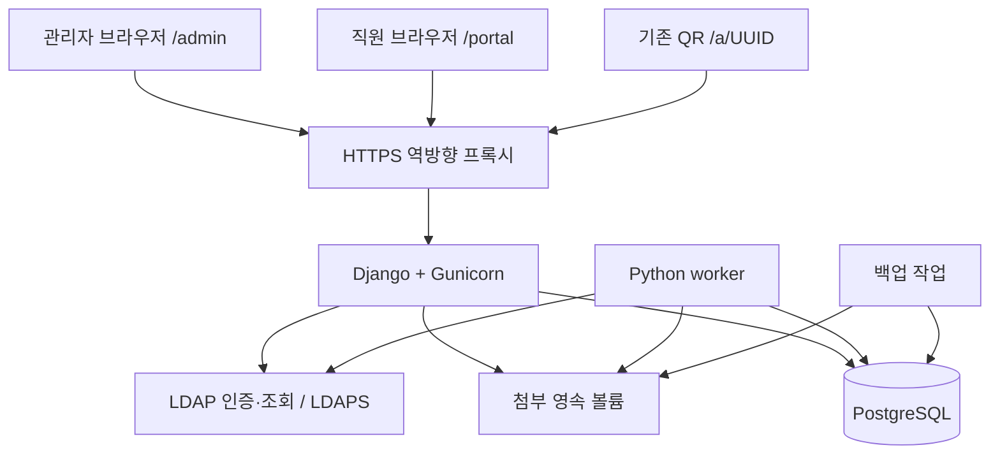
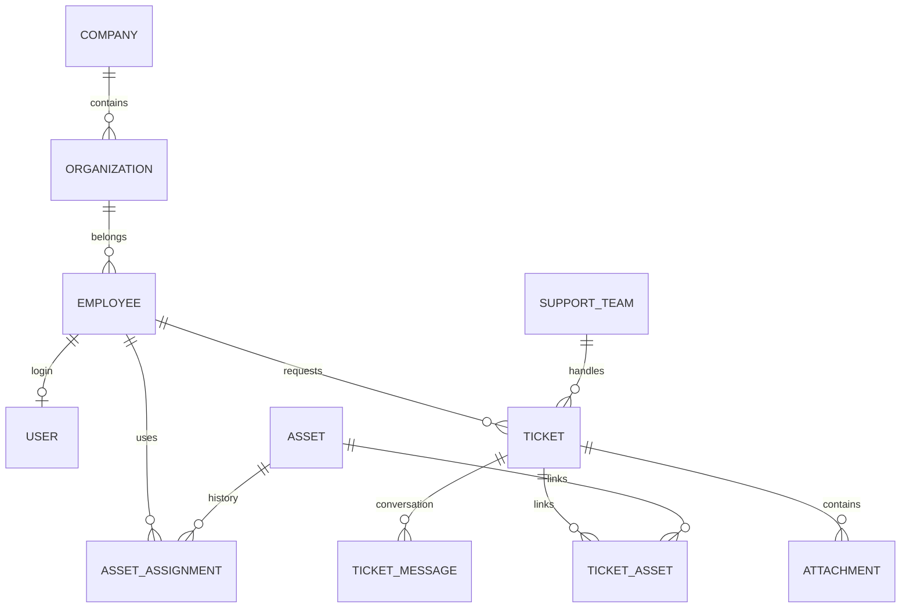

# BUMJIN IT 통합 운영 시스템 TRD

| 항목 | 내용 |
| --- | --- |
| 버전 | v1.0 |
| 작성일 | 2026-11-12 |
| 상태 | 기술 설계 제안서 — 기술 선택·운영 수치 미확정 |
| 관련 문서 | [PRD](./PRD.md), [UI 명세서](./UI_SPEC.md) |
| 대상 | ITAM, 티켓, 조직·직원, 직원 포털 |
| 개발 방향 | 기존 Python 시스템 확장, PHP 사용 안 함 |

## 1. 목적과 의사결정 상태

이 문서는 PRD와 UI 명세서의 기능을 실제로 구현하기 위한 아키텍처, 데이터, API, 인증·권한, 이관·운영 기준을 정의한다. 코드 구현이나 DB·운영 환경 변경을 수행하는 문서는 아니다.

### 1.1 사용자 확정 사항

- PHP를 사용하지 않고 Python으로 개발한다.
- 기존 Bumjin_ITAM의 UI 디자인을 유지한다.
- 관리자 `/admin`과 일반 직원 `/portal` 경로를 분리한다.
- 관리자 홈을 티켓·자산·조직 통합 운영 대시보드로 제공한다.
- 기존 자산관리 위에 티켓 및 조직·직원 기능을 연결한다.

### 1.2 이 문서의 기술 권고안

| 항목 | 권고안 | 상태 |
| --- | --- | --- |
| 웹 프레임워크 | Django 5.2 LTS 계열 | 제안 |
| API | Django REST Framework, 세션 인증 | 제안 |
| Python | 3.12 계열 | 제안, NAS 이미지 호환 확인 필요 |
| DB | PostgreSQL 16 계열 | 제안, NAS 자원 확인 필요 |
| 화면 | Django 템플릿 + 기존 HTML/CSS/일반 JavaScript | 제안 |
| 앱 서버 | Gunicorn WSGI | 제안 |
| 배포 | Synology NAS + Docker Compose + HTTPS 역방향 프록시 | 제안 |
| 파일 | NAS 영속 볼륨, API 권한 검사 후 다운로드 | 제안 |
| 작업 처리 | PostgreSQL 기반 작업 테이블 + 전용 Python worker | 제안 |

정확한 패치 버전과 패키지 조합은 구현 시작 시 보안 지원·호환성을 확인한 뒤 lock 파일에 고정한다. Django·PostgreSQL 도입을 사용자가 이미 승인한 것으로 해석하지 않는다. 승인 전에는 현재 운영 구조를 변경하지 않는다.

## 2. 현재 구조와 기술 부채

저장소의 README, `backend/app.py`, `auth_service.py`, `organization_service.py`, `requirements.txt`, `docker-compose.yml` 기준이다. 실제 NAS 배포 상태는 별도 확인한다.

| 영역 | 현재 | 확장 시 필요한 변경 |
| --- | --- | --- |
| 서버 | Python WSGI, wsgiref 기반 | 운영용 서버와 프레임워크 |
| 데이터 | openpyxl로 XLSX 읽기·쓰기 | 트랜잭션·관계·검색 가능한 DB |
| 세션 | 프로세스 메모리, admin/viewer | 개인 계정·공유 세션 저장·세부 권한 |
| 권한 | 로컬 관리자, LDAP 조회 전용 직원 | 역할·법인·지원팀·본인 조건 |
| 자산 | 등록·배정·수거·QR·라벨·이력 | 직원 ID와 연결, 티켓 연결 |
| 조직 | Excel 조직 트리, LDAP 부서 수정 | 조직 변경과 직원 소속 이력 |
| 충돌 | 파일 revision·잠금·저장 전 백업 | 행 단위 버전 검사·DB 제약 |
| 외부 쓰기 | LDAP와 Excel 별도 저장 | 외부 작업 상태·재확인·복구 |
| 배포 | NAS, 읽기 전용 컨테이너·data 볼륨 | web·worker·DB·파일의 개별 영속화 |

메모리 세션을 여러 worker에서 그대로 사용하거나 동일 Excel에 여러 프로세스가 쓰도록 확장하지 않는다.

## 3. 아키텍처

### 3.1 구성



- 한 코드베이스를 업무 모듈로 나눈 모듈형 모놀리스를 사용한다.
- 초기부터 마이크로서비스, Kubernetes, 별도 검색 서버를 도입하지 않는다.
- 같은 origin에서 페이지·API를 제공해 쿠키·CSRF·배포를 단순화한다.
- 직원과 관리자는 다른 경로·응답 스키마를 사용하며 업무 서비스는 공유한다.
- DB를 유일한 업무 원본으로 사용하고 Excel은 이관·일괄 입력·내보내기로 전환한다.
- Sites 목업 호스팅은 실서비스의 Python 배포 환경으로 사용하지 않는다.

### 3.2 Django 권고 근거

| 고려 항목 | 판단 |
| --- | --- |
| 개인 계정·세션·비밀번호 | Django의 검증된 인증·세션 기능 활용 |
| 조직·티켓·자산 관계 | ORM·트랜잭션·마이그레이션 활용 |
| 기존 디자인 | 템플릿과 JavaScript로 기존 화면 재사용 |
| LDAP | 사용자 정의 인증 backend에서 ldap3 재사용 |
| 인수인계 | 프레임워크 표준 구조로 유지보수 부담 축소 |

FastAPI도 가능하지만 이번 시스템은 인증·관리·관계형 CRUD의 비중이 크므로 Django를 우선 제안한다. 두 프레임워크를 함께 운영하지 않는다. Django 기본 관리자 화면은 사용자가 보는 `/admin`과 구분한다. 기본 admin URL을 `/admin/`에 연결하지 않으며, 내부 관리 도구가 필요하면 별도 제한 경로에서만 제공한다.

### 3.3 모듈 구조 제안

```text
config/                 설정, URL, WSGI
apps/
  identity/             사용자, LDAP 인증, 세션
  access/               역할·범위·정책
  organizations/        법인, 조직, 직원, 소속 이력
  assets/               자산, 배정, 상태, SW 기재 정보
  tickets/              요청, 팀, 상태, 대화, 자산 연결
  maintenance/          유지보수·계약
  files/                첨부·다운로드
  notifications/        앱 내 알림
  audit/                업무·관리 변경 감사
  jobs/                 외부 작업, 재시도, 실행 이력
  imports/              Excel 준비·검증·이관
  dashboard/            범위가 적용된 집계
  web/                  관리자·직원 템플릿
static/                 기존 CSS, JavaScript, QR 자원
management/commands/    worker, 이관, 대조, 복구 점검
```

라우트 → 입력 검증 → 권한 정책 → 업무 서비스 → ORM 순서로 호출한다. 화면용 view·API·worker에서 동일 업무 규칙을 호출한다. 데이터베이스 변경과 LDAP 호출을 view에 직접 섞지 않는다.

## 4. 데이터 모델

### 4.1 공통 규칙

- 주요 업무 엔터티는 UUID 기본키를 사용한다. 기존 자산 UUID는 재발급하지 않는다.
- 시각은 timezone-aware UTC로 저장하고 기본 한국 시간으로 표시한다.
- 금액은 정수 원 또는 Decimal로 저장하며 부동소수점을 사용하지 않는다. 통화 필드를 둔다.
- 업무 변경 대상에 `created_at`, `updated_at`, `version` 정수를 둔다.
- 법인·직원·자산·티켓은 이력 유지를 위해 비활성·종료 처리한다. 참조가 있는 행을 연쇄 삭제하지 않는다.
- FK 기본 삭제 정책은 PROTECT/RESTRICT이며 예외를 명시한다.
- 이름·이메일·UID를 업무 레코드의 기본키로 사용하지 않는다.
- 확장 JSON 필드는 원본 보존·부가 사양용이다. 권한·상태·관계·핵심 검색 필드는 정규 컬럼으로 둔다.

### 4.2 핵심 테이블

| 엔터티 | 핵심 필드·제약 |
| --- | --- |
| Company | id, code UNIQUE, name, active |
| Organization | id, company_id, parent_id, name, active, version |
| Employee | id, employee_no, name, email, company_id, organization_id, employment_status, retired_at, version |
| EmploymentHistory | employee_id, 이전·이후 법인/조직, effective_at, actor_id, reason |
| DirectoryIdentity | directory_source_id, stable_id, uid, dn, employee_id, last_seen_at, sync_status |
| User | Django 사용자 확장, employee_id nullable UNIQUE, active, auth_type, auth_version |
| RoleGrant | user_id, role, scope_type, company_id nullable, active |
| SupportTeam | id, name, active |
| SupportTeamCompany | team_id, company_id UNIQUE 조합 |
| TeamMembership | team_id, user_id UNIQUE 조합, active |
| Asset | 기존 id, company_id, number, category, status, organization_id, location, 사양, 구매·보증 정보, version |
| AssetAssignment | asset_id, employee_id nullable, organization_id, assigned_at, returned_at, actor_id, reason |
| AssetEvent | asset_id, action, before, after, actor_id, happened_at, source |
| SoftwareRecord | asset_id, product_name, recorded_version, usage_value, source |
| MaintenanceContract | id, vendor, service, company_id, 기간·비용·담당·비고, 원본 참조 |
| ContractAsset | contract_id, asset_id UNIQUE 조합 |
| Ticket | id, number UNIQUE, company_id, requester_id, created_by_id, 소속 스냅샷, type, category, status, priority, team_id nullable, assignee_id nullable, due_at nullable, resolved_at, closed_at, version |
| TicketAsset | ticket_id, asset_id UNIQUE 조합, 연결 당시 식별 정보 |
| TicketMessage | id, ticket_id, author_id, visibility, body, revision, created_at |
| MessageRevision | message_id, revision, 이전 본문, editor_id, edited_at |
| TicketEvent | ticket_id, event_type, before, after, actor_id, happened_at |
| Attachment | id, ticket_id, message_id nullable, visibility, storage_key, original_name, size, media_type, checksum, status |
| Notification | recipient_id, ticket_id nullable, event_id, read_at, created_at |
| AuditEvent | actor_id, action, target_type, target_id, company_id nullable, before, after, request_id, created_at |
| Job | id, type, payload, status, attempts, run_after, lease_until, result, error_code |
| ExternalOperation | id, target_identity_id, kind, before, desired, status, batch_id, verification_result |
| ImportBatch / ImportRow | 원본 checksum, parser_version, 행 식별자, 검증·매핑·적용 결과 |
| IdempotencyRecord | user_id, endpoint, key, payload_hash, response_ref, expires_at |

### 4.3 관계 개요



### 4.4 조직·인물 식별

- 직원과 로그인 계정을 분리한다. 계정 없는 직원에게도 자산을 배정할 수 있다.
- LDAP 식별자는 `(directory_source_id, stable_id)` UNIQUE로 관리한다.
- 같은 UID가 다른 stable_id로 나타나면 기존 직원에 자동 합치지 않고 확인 대상을 생성한다.
- LDAP 계정 이름·이메일·DN 변경은 고유 ID 기준으로 연결한다.
- MVP는 직원의 현재 주 소속 한 개를 기준으로 한다. 겸직·복수 법인 재직은 별도 확장 대상이다.
- 조직 parent는 동일 법인이어야 하며 순환·최대 깊이 위반을 차단한다. 기존 12단계 제한을 초기 호환값으로 유지한다.
- 동시 조직 이동 시 법인별 잠금과 현재 트리 재검증을 통해 순환을 막는다.
- 법인당 같은 부모 아래 동일 이름을 허용하지 않는다. 루트는 parent NULL의 UNIQUE 동작을 고려한 별도 부분 고유 인덱스를 둔다.

### 4.5 DB 무결성·인덱스

필수 제약:

- 자산 관리번호 `(company_id, number)` UNIQUE.
- `AssetAssignment(asset_id) WHERE returned_at IS NULL` 부분 UNIQUE: 현재 배정 최대 한 개.
- 직원 없는 배정은 관리 조직이 반드시 있어야 한다.
- `returned_at >= assigned_at` CHECK.
- `TicketAsset(ticket_id, asset_id)` UNIQUE.
- Ticket.number는 DB sequence 또는 전용 원자적 번호 발급으로 생성한다. `MAX()+1`을 사용하지 않는다.
- 조직·자산·계약·직원 소속의 법인 일치는 서비스 검증과 필요한 복합 FK/DB 제약으로 강제한다.
- 지원팀은 연결된 법인, 담당자는 해당 법인·팀에서 처리 가능한 계정인지 검사한다.

조회 인덱스:

- Ticket `(company_id, status, created_at DESC, id)`.
- Ticket `(assignee_id, status)`, `(team_id, status)`, `(requester_id, created_at DESC)`.
- Ticket `(company_id, due_at)`의 미종료 부분 인덱스.
- Message `(ticket_id, created_at, id)`.
- Assignment `(employee_id, returned_at)`.
- Asset `(company_id, status)`, 관리번호·시리얼 검색 인덱스.
- Job `(status, run_after)`, Notification `(recipient_id, read_at, created_at)`.

필요한 인덱스는 실제 실행 계획·데이터량으로 확인한다. 한글 검색은 초기 ILIKE 기반으로 시작하되 부하 기준을 넘으면 PostgreSQL trigram 인덱스를 평가한다.

## 5. 상태·업무 규칙

### 5.1 자산 상태

| 내부 코드 | 기존 UI 표시 | PRD 의미 |
| --- | --- | --- |
| IN_USE | 사용 | 사용 중 |
| IN_STOCK | 보관 | 재고 |
| REPAIR | 수리 | 수리 중 |
| LOST | 분실 | 분실 |
| DISPOSED | 폐기 | 폐기 |

기존 표시명을 보존하는 것을 기본 제안으로 하고 API는 내부 코드와 표시명을 구분한다. 이관에서 알 수 없는 상태를 임의로 보관 처리하지 않고 검토 목록으로 보낸다.

배정·반납은 Asset 행 잠금, version 검사, 배정 이력, 상태 변경, 감사 이력을 하나의 DB 트랜잭션으로 처리한다. 퇴사자·폐기 자산 신규 배정을 차단한다. 수리·분실 중 기존 배정 유지 여부는 상태 정책으로 명시하며 자동 반납하지 않는다.

MVP에서는 자산 소유 법인의 사후 변경을 제한한다. 법인 간 이전은 기존 티켓·소유 이력·권한의 영향을 다루는 별도 업무로 확장한다. 직원의 소속 변경은 자산 소유 법인을 변경하지 않는다.

### 5.2 티켓 상태

| 코드 | 화면 표시 |
| --- | --- |
| NEW | 접수 |
| IN_PROGRESS | 처리 중 |
| WAITING_REQUESTER | 요청자 답변 대기 |
| WAITING_VENDOR | 외부 업체 대기 |
| RESOLVED | 해결 |
| CLOSED | 종료 |
| CANCELLED | 취소 |

허용 전이 제안:

| 이전 | 이후 | 조건 |
| --- | --- | --- |
| NEW | IN_PROGRESS | 담당자 지정, 처리 권한 |
| NEW / IN_PROGRESS | 대기 상태 | 대기 사유, 담당자 지정 |
| 대기 상태 | IN_PROGRESS | 담당자 처리 재개 |
| IN_PROGRESS / 대기 상태 | RESOLVED | 해결 내용 필수 |
| RESOLVED | CLOSED | 요청자 확인 또는 권한 있는 담당자의 사유 |
| RESOLVED / CLOSED | IN_PROGRESS | 재개 사유, 유효 담당자 지정 |
| 미종료 상태 | CANCELLED | 취소 사유, 권한 |

- RESOLVED/CLOSED/CANCELLED는 대시보드 미종료 집계에서 제외한다.
- CANCELLED 재개는 초기 범위에서 제외하고 후속 정책으로 둔다.
- 직원은 공개 답변을 등록할 수 있다. 답변만으로 상태를 자동 전환하지 않는 것을 초기 제안으로 한다.
- 직원의 해결 확인·재개는 전용 action을 통해 제한적으로 허용한다. 일반 상태 PATCH를 허용하지 않는다.
- `claim`은 담당 팀을 유지하며 담당자를 본인으로 지정한다. NEW이면 IN_PROGRESS로 전환한다.
- 다른 담당자 재배정에는 별도 권한과 예상 version을 요구한다. 이미 본인인 재인수는 무변경 성공으로 처리한다.
- 상태·담당자 변경, 공개 해결 답변, 이벤트·감사는 같은 트랜잭션에 기록한다.
- 티켓 해결은 자산 상태를 자동 변경하지 않는다.
- MVP에서 자동 종료·영업시간 SLA 계산은 도입하지 않는다.

### 5.3 티켓과 자산·조직 연결

- 티켓 company는 등록 당시 요청 범위로 확정하며 임의 변경하지 않는다.
- 관련 자산은 등록 시 권한을 검사하고 동일 회사 자산을 기본으로 제한한다.
- 직원 API에서 관련 자산은 현재 본인 배정 범위만 상세 노출한다. 과거 연결 자산이 다른 사람에게 재배정되면 현재 사용자·새 개인정보를 노출하지 않는다.
- 티켓 요청 당시 직원명·소속명·조직 경로는 스냅샷으로 보존한다.
- 직원 이동 후에도 과거 본인 요청 조회를 유지하는 것을 제안한다. 본인 여부는 이름·현재 조직이 아닌 requester_id로 판정한다.
- 첨부·대화·이력의 접근 권한은 부모 티켓보다 넓어질 수 없다.

## 6. 인증·세션

### 6.1 로그인

1. 로그인 폼의 CSRF를 검증한다.
2. 로컬 복구 계정 또는 LDAP 계정의 인증 방식을 확인한다.
3. LDAP는 LDAPS 인증서·호스트명을 검증하고 필터 값을 escape한다.
4. 조회 계정으로 고유 ID를 확인한 뒤 사용자 DN으로 비밀번호 bind한다.
5. 안정적인 DirectoryIdentity와 User 연결을 검증한다. 미매핑·중복은 자동 관리자 생성 없이 처리한다.
6. 앱의 active·재직·역할 상태를 확인한다.
7. 세션 ID를 회전하고 역할에 맞는 허용 경로로 이동한다.

LDAP 비밀번호는 저장·로그·작업 payload에 남기지 않는다. LDAP 장애를 비밀번호 성공 또는 관리자 권한으로 대체하지 않는다. 자동 최초 계정 생성은 활성 직원의 고유 ID 매핑이 확인된 경우만 허용하는 정책을 제안한다.

### 6.2 세션·CSRF

- Django DB 세션을 사용한다. 초기에는 Redis가 없어도 여러 web worker가 세션을 공유한다.
- 세션 쿠키: HttpOnly, Secure, SameSite=Lax, path=/.
- CSRF는 Django 표준 middleware와 `X-CSRFToken`을 사용한다. 로그인에도 명시 적용한다.
- HTTPS 동일 origin을 기본으로 하고 불필요한 cross-origin 자격 증명 요청을 허용하지 않는다.
- 초기 세션 최대 수명은 기존과 같은 8시간을 제안한다. 유휴 만료 정책은 별도 확정한다.
- 로그아웃·계정 비활성·퇴사·비밀번호 변경·중요 역할 변경 시 해당 세션을 폐기하거나 auth_version 불일치로 거부한다.
- 역할은 세션의 오래된 값만 신뢰하지 않고 요청 시 현재 grant와 사용자 상태를 검사한다.
- next는 같은 origin의 허용 경로·쿼리만 허용하고 외부 URL·프로토콜 상대 URL을 차단한다.
- 기존 메모리 세션은 이관하지 않는다. 전환 후 재로그인한다.
- 로그인 시도 제한은 DB 기반으로 계정·IP 단위 적용해 worker별 우회를 방지한다. 구체적인 횟수·시간은 운영 정책으로 확정한다.

### 6.3 역할별 기본 진입 제안

일반 직원은 `/portal`, 업무 관리 권한이 있는 계정은 `/admin`으로 진입한다. 다중 역할 사용자는 허용된 영역 전환을 제공한다. 시스템 설정 권한만 있는 사용자의 홈·업무 데이터 노출은 해당 권한에 맞게 제한한다. 이 기본값은 정책 확정 전 제안이다.

## 7. 권한 모델

### 7.1 역할·범위

| 역할 | 주요 권한 |
| --- | --- |
| employee | 본인 자산·본인 요청·공개 답변 |
| support_agent | 허용 법인 및 지원팀의 티켓·관련 조회 |
| asset_manager | 허용 법인의 자산 변경 |
| organization_manager | 허용 법인의 조직·직원 변경 |
| system_admin | 계정·권한·LDAP·운영 설정 |

- RoleGrant는 역할과 법인 범위를 같은 행에 묶는다. 다른 grant의 역할과 범위를 곱해 권한을 넓히지 않는다.
- scope_type은 COMPANY 또는 명시적인 GLOBAL이다. company NULL을 암묵적 전체 권한으로 해석하지 않는다.
- 지원팀 멤버십만으로 법인 권한을 부여하지 않는다.
- 관리자 경로 접근은 관련 관리 역할 존재를 요구하고 실제 데이터는 별도 범위로 제한한다.
- Django `is_staff`만으로 업무 API 권한을 부여하지 않는다.
- system_admin의 기본 권한은 설정 관리다. 티켓 본문·자산 수정에는 해당 업무 역할을 추가로 부여하는 것을 제안한다.
- 복구 계정의 광범위 권한은 별도 비상 절차·감사로 관리하고 일상 계정과 구분한다.

### 7.2 조회 정책

권한은 `visible_to(user)`와 `can_perform(user, action, object)` 형태의 중앙 정책으로 구현한다.

- 직원 티켓: `requester_id == current_user.employee_id`.
- 직원 자산: 현재 열린 배정의 employee_id가 본인.
- 지원 티켓: 동일 grant의 허용 법인 AND 접근 가능한 지원팀.
- 팀 없는 큐 접근은 별도 접수 관리 권한으로 정의한다. 팀 NULL을 전체 공개로 취급하지 않는다.
- 요청자와 담당자가 같은 경우에도 직원 API는 직원 응답 스키마만 반환한다.
- 전체 건수·자동완성·검색 결과·첨부·알림·내보내기에도 같은 범위를 적용한다.
- 목록을 모두 가져온 뒤 JavaScript에서 숨기는 방식을 사용하지 않는다.

리소스 없는 경우와 범위 밖인 경우는 404로 통일한다. 인증 없음은 401, 명시적으로 금지된 기능은 403이다.

## 8. 페이지·API 계약

### 8.1 경로

UI 경로는 UI_SPEC을 따른다. `/admin`은 통합 홈이며 설정은 `/admin/settings`다. `/portal`은 직원 전용 홈이다. API는 `/api/v1/` 아래에서 관리와 직원을 분리한다.

### 8.2 대표 API

| 메서드·경로 | 기능 |
| --- | --- |
| GET `/api/v1/auth/csrf` | 로그인·변경 요청용 CSRF 준비 |
| POST `/api/v1/auth/login` | 로그인 |
| POST `/api/v1/auth/logout` | 세션 폐기 |
| GET `/api/v1/auth/me` | 본인·역할·진입 가능 영역 |
| GET `/api/v1/admin/dashboard` | 범위별 통합 집계 |
| GET/POST `/api/v1/admin/tickets` | 티켓 목록·대리 등록 |
| GET/PATCH `/api/v1/admin/tickets/{id}` | 상세·허용 필드 수정 |
| POST `/api/v1/admin/tickets/{id}/claim` | 담당자 인수 |
| POST `/api/v1/admin/tickets/{id}/transition` | 상태 변경·해결·종료·재개 |
| GET/POST `/api/v1/admin/tickets/{id}/messages` | 공개 답변·내부 메모 |
| PATCH `/api/v1/admin/messages/{id}` | 수정·버전 이력 |
| GET/POST `/api/v1/admin/assets` | 자산 목록·등록 |
| GET/PATCH `/api/v1/admin/assets/{id}` | 자산 상세·수정 |
| POST `/api/v1/admin/assets/{id}/assign` | 사용자·공용 배정 |
| POST `/api/v1/admin/assets/{id}/return` | 반납 |
| GET `/api/v1/admin/assets/{id}/tickets` | 연결 티켓 |
| GET/POST/PATCH `/api/v1/admin/organizations[/{id}]` | 조직 관리 |
| GET/PATCH `/api/v1/admin/employees[/{id}]` | 직원 관리 |
| POST `/api/v1/admin/employees/{id}/change-preview` | 이동·퇴사 영향 확인 |
| POST `/api/v1/admin/employees/{id}/apply-change` | DB 소속·재직 변경 |
| GET/POST/PATCH `/api/v1/admin/contracts[/{id}]` | 유지보수 계약 |
| POST `/api/v1/admin/imports/preview` | Excel 업로드·검증 작업 |
| POST `/api/v1/admin/imports/{id}/apply` | 검토한 이관 적용 |
| GET `/api/v1/admin/imports/{id}` | 결과·오류·매핑 확인 |
| POST `/api/v1/admin/directory-syncs` | LDAP 가져오기 작업 |
| POST `/api/v1/admin/directory-writes/preview` | LDAP 부서 변경 사전 확인 |
| POST `/api/v1/admin/directory-writes` | 확인된 LDAP 변경 작업 생성 |
| GET `/api/v1/admin/jobs/{id}` | 진행·부분 실패·결과 |
| GET `/api/v1/portal/summary` | 본인 요약 |
| GET `/api/v1/portal/assets[/{id}]` | 현재 본인 자산·제한 상세 |
| GET/POST `/api/v1/portal/tickets` | 본인 요청·신규 요청 |
| GET `/api/v1/portal/tickets/{id}` | 본인 요청 상세 |
| POST `/api/v1/portal/tickets/{id}/messages` | 본인 공개 답변 |
| POST `/api/v1/portal/tickets/{id}/confirm-resolution` | 해결 확인 |
| POST `/api/v1/portal/tickets/{id}/reopen` | 사유를 포함한 재개 |
| GET `/api/v1/notifications` | 본인 앱 알림 |
| POST `/api/v1/notifications/{id}/read` | 읽음 |
| POST `/api/v1/{admin|portal}/tickets/{id}/attachments` | 권한 범위 내 첨부 업로드 |
| GET `/api/v1/files/{id}/download` | 매번 권한 검사 후 다운로드 |

`[/{id}]` 표기는 목록·단건 경로를 줄여 쓴 것이다. 실제 OpenAPI에서는 각 경로·메서드를 개별 명세한다. API 초안이며 구현 시 필드 단위 스키마와 오류 예시를 보완한다.

직원 API는 requester_id·company_id·visibility·assignee를 클라이언트에서 임의 설정할 수 없다. 본인·소속·공개 범위를 서버에서 결정하고 금지 필드는 오류로 반환한다.

### 8.3 입력·응답

목록 기본 30건, page_size 최대 100건. 정렬은 `(created_at DESC, id DESC)` 등 안정적인 기준을 사용한다. 필터 허용값을 명시하고 임의 ORM 필드명을 받지 않는다.

```json
{
  "data": [],
  "meta": {"page": 1, "page_size": 30, "total": 0},
  "request_id": "opaque-request-id"
}
```

```json
{
  "error": {
    "code": "VERSION_CONFLICT",
    "message": "다른 변경이 있습니다. 최신 내용을 확인하세요.",
    "fields": {}
  },
  "request_id": "opaque-request-id"
}
```

| HTTP | 의미 |
| --- | --- |
| 200/201 | 조회·변경·생성 성공 |
| 202 | 작업 접수, job_id 반환 |
| 400 | JSON·필드·허용값 검증 실패 |
| 401/403/404 | 인증·권한·조회 범위 |
| 409 | version 충돌, 상태 전이·배정 무결성 충돌 |
| 413 | 요청·파일 크기 초과 |
| 429 | 로그인·요청 제한 |
| 503 | DB·LDAP 등 필수 외부 서비스 일시 불가 |

직원 응답 serializer는 관리자 응답에서 일부 필드를 삭제하는 후처리가 아니라 명시적 허용 필드 목록으로 별도 정의한다.

### 8.4 버전 검사·중복 방지

- 주요 PATCH·action은 `expected_version`을 필수로 받는다.
- DB에서 `id AND version`을 조건으로 갱신하고 0건이면 409를 반환한다.
- 배정·조직 변경처럼 여러 행 규칙이 있는 경우 transaction.atomic 및 행 잠금을 결합한다.
- 티켓 생성·배정·해결·외부 작업 생성은 `Idempotency-Key`를 지원한다.
- `(user, endpoint, key)` UNIQUE를 DB에서 강제하고 요청 hash를 비교한다.
- 같은 키·다른 본문은 409, 같은 키·같은 본문은 기존 결과를 반환한다.
- DB 변경과 멱등 결과 기록은 한 트랜잭션에서 커밋한다. worker와 외부 호출도 별도 안정적인 작업 ID를 사용한다.

### 8.5 입력 제한 초기 제안

| 항목 | 초기 제한 |
| --- | --- |
| 티켓 제목 | 1~200자 |
| 요청 본문·답변·해결 내용 | 공백 제외 필수, 최대 20,000자 |
| 조직명 | 기존과 같은 1~80자, `/`·제어문자 금지 |
| 첨부 | 파일당 20MB, 업로드 요청당 최대 5개 |
| 대량 작업 | 자산·직원별 허용 수량 별도 제한 |

첨부 허용 형식은 PDF, PNG/JPEG, TXT/CSV, XLSX/DOCX를 초기 제안으로 한다. HTML·SVG·실행 파일·압축 묶음은 초기 제외한다. MIME·확장자·내용 검증을 조합한다. 제한은 UI·API·프록시를 일치시키고 프록시 상한은 multipart 전체 크기를 고려한다.

## 9. 대시보드·검색·실시간성

대시보드와 목록은 동일한 접근 범위 QuerySet과 큐 조건 함수를 사용한다.

| 지표 | 서버 조건 |
| --- | --- |
| 진행 중 | status IN NEW, IN_PROGRESS, WAITING_REQUESTER, WAITING_VENDOR |
| 미배정 | 진행 중 AND assignee IS NULL |
| 기한 초과 | 진행 중 AND due_at IS NOT NULL AND due_at < as_of |
| 답변 대기 | status = WAITING_REQUESTER |
| 내 티켓 | 진행 중 AND assignee = current_user |

- 한 응답의 as_of를 고정하고 집계·목록 조회에 동일 시각을 사용한다.
- 여러 집계를 하나의 SQL 조건부 집계로 처리하고, 목록을 함께 반환하면 짧은 읽기 전용 일관 스냅샷 트랜잭션으로 맞춘다.
- 응답에 적용된 scope·queue·filters·as_of를 포함한다. 프런트에서 전체 값을 재계산하지 않는다.
- 초기에는 집계 캐시를 사용하지 않는다. 변경 후 관련 목록·집계를 재조회한다.
- 자동 갱신은 화면 활성 시 30~60초 간격 polling을 제안한다. 숨은 탭은 중지하고 실패 시 backoff한다.
- 답변 작성 중 자동 갱신은 입력·포커스·스크롤을 초기화하지 않는다.
- WebSocket·SSE는 MVP 필수가 아니다.
- 통계 0과 조회 실패·로딩을 구분한다.
- 목표 처리일은 MVP에서 명시 timestamp로 관리한다. 날짜만 입력하면 한국 시간의 해당 일 종료 시각으로 변환하는 정책을 제안하며 사용자에게 표시한다.

## 10. 첨부·파일 저장

### 10.1 저장 절차

1. 인증·티켓·가시성 권한 및 업로드 한도를 검사한다.
2. UUID 기반 staging 경로에 스트리밍 저장하고 크기·형식·checksum을 검증한다.
3. DB에 STAGED 메타데이터를 기록한다.
4. 같은 파일시스템 내 원자적 rename으로 최종 위치에 옮긴다.
5. AVAILABLE로 전환하고 메시지에 연결한다. 중간 실패는 정리 작업으로 복구한다.

DB와 파일시스템은 단일 원자 트랜잭션이 아니므로 상태 전이를 통해 조정한다. STAGED·FAILED 파일은 다운로드하지 않는다. DB 참조 없는 staging 파일은 유예 후 정리하고 참조가 있는 파일은 무조건 삭제하지 않는다.

### 10.2 다운로드·접근

- 원본 파일명을 저장 경로로 사용하지 않는다. 상대 경로·상위 경로 이동을 차단한다.
- 파일 디렉터리는 정적 공개 경로 밖에 둔다.
- 다운로드마다 현재 티켓·메시지 visibility·계정 권한을 검사한다.
- 응답은 안전한 Content-Disposition attachment, nosniff, 적절한 media type을 사용한다.
- 최초 MVP는 첨부 인라인 HTML 렌더링을 하지 않는다.
- 내부 메모 첨부는 해당 메시지 이상의 공개 범위를 가질 수 없다.
- 메시지 visibility의 공개 확대는 첨부도 함께 검사한다. 초기에는 내부→공개 전환 대신 새 공개 답변 작성 정책을 권장한다.
- 바이러스 검사를 도입하는 경우 PENDING_SCAN 상태에서 다운로드를 막는다. 검사 서비스 사용 여부는 운영 전 확정한다.

## 11. LDAP·조직·직원 변경

### 11.1 원본 정책 제안

| 데이터 | 원본 |
| --- | --- |
| 인증, 디렉터리 고유 ID | LDAP |
| 이름·이메일 | LDAP 가져오기 |
| 앱 조직·소속·재직·권한 | 앱 DB |
| 자산·티켓·계약 | 앱 DB |

LDAP 부서를 앱 조직으로 읽는 초기 매핑과 앱에서 LDAP 부서로 내보내는 작업을 구분한다. 이후 가져오기가 앱 소속을 무조건 덮어쓰지 않는다. 차이를 미리보기 대상으로 제시한다.

### 11.2 가져오기

- 전체 조회 성공 여부와 페이지 완결성을 확인한 실행만 정상 snapshot으로 인정한다.
- 결과를 staging 테이블에 적재하고 추가·변경·누락·식별 충돌을 비교한다.
- 연결 실패·일부 조회·타임아웃은 사용자 누락이나 퇴사로 확정하지 않는다.
- 미리보기와 적용 사이 외부 값이 바뀌면 다시 검증한다.
- 원본 고유 ID·최종 확인 시각·실행 ID를 보존한다.
- 비활성 판정은 관리자가 확인하거나 별도 확정된 정책을 거친다.

### 11.3 LDAP 부서 쓰기

`PREPARED → PENDING → SUCCEEDED / FAILED / UNKNOWN → VERIFIED`

- 앱 소속 변경과 LDAP 쓰기를 별도 사실로 저장한다.
- 실제 LDAP 호출 전에 DB에 durable 작업·대상별 이전값·기대값을 커밋한다.
- stable_id와 UID, 현재 부서값을 사전 확인하고 가능하면 LDAP assertion control로 이전값 일치를 서버에서 강제한다.
- assertion을 지원하지 않는 서버는 동시 외부 수정 보호가 제한됨을 명시하고 변경 전후 재조회로 확인한다.
- 명시적 거부는 FAILED, 응답 유실·연결 종료로 결과 불명확하면 UNKNOWN이다.
- UNKNOWN은 자동 쓰기 재시도하지 않고 읽기 검증한다. desired 일치면 성공 확인, before 일치면 미적용 확인, 제3의 값이면 관리자 충돌 확인으로 분류한다.
- 배치별 성공·실패·확인 필요·미처리를 반환하고 다른 사람의 성공을 임의로 롤백하지 않는다.
- 계정 생성·DN 이동·비밀번호 변경·OU 생성은 초기 범위에서 제외한다.

### 11.4 직원 이동·퇴사

- preview는 대상 직원 version과 관련 업무 요약을 반환한다.
- apply는 version을 다시 검사하고 소속·재직·감사 이력을 DB 트랜잭션으로 반영한다.
- 퇴사 시 앱 로그인을 차단하고 세션을 폐기한다. LDAP 계정 자체 비활성화는 별도 관리 업무다.
- 미반납 자산과 담당 중 티켓은 삭제·자동 반납하지 않고 후속 작업 대상으로 남긴다.
- 자산 소유·관리 부서와 티켓 요청 당시 소속은 자동 변경하지 않는다.

## 12. 백그라운드 작업·알림

초기 Redis/Celery 추가 없이 PostgreSQL 작업 큐를 제안한다. 구조가 커지면 외부 큐로 교체할 수 있도록 업무 로직과 실행기를 분리한다.

- web은 업무 변경과 Job/Notification 이벤트를 같은 DB 트랜잭션에 적재한다.
- worker는 `SELECT ... FOR UPDATE SKIP LOCKED`로 작업을 인수하고 lease를 기록한 뒤 잠금을 해제한다.
- 네트워크 호출 중 DB 트랜잭션을 장시간 유지하지 않는다.
- 작업은 적어도 한 번 실행될 수 있으므로 작업·알림 생성은 고유 이벤트 키로 멱등 처리한다.
- LDAP 응답 불명확 작업은 일반 재시도 큐와 분리한다.
- 일반 읽기·알림 작업은 지수 backoff, 최대 시도 수, 실패 상태·관리자 확인을 제공한다.
- lease 만료 재인수 시 외부 작업 상태를 먼저 검사한다.
- 정기 작업은 한 scheduler만 실행하거나 DB advisory lock으로 중복 등록을 방지한다.
- 작업 상태: QUEUED, RUNNING, SUCCEEDED, PARTIAL, FAILED, NEEDS_REVIEW.
- 앱 알림은 받는 사람과 사건을 기준으로 저장하고 본인 행동의 자기 알림은 생략하는 것을 제안한다.
- 직원 알림은 공개 사실만 포함한다. 알림 클릭 시 현재 권한을 다시 검사한다.
- 이메일·Teams·Slack 발송은 MVP 이후다.

## 13. Excel·기존 데이터 이관

### 13.1 재사용·교체

| 기존 코드 | 방향 |
| --- | --- |
| 자산 파싱·번호 규칙 | 순수 변환 함수로 분리해 재사용 |
| label_pdf.py·QR | UUID·URL 보존, Django 응답·권한에 연결 |
| ldap3 연결·이전값 검증 | 인증 backend·외부 작업 서비스로 분리 |
| organization_service.py 규칙 | 조직·동기화 서비스에 이식 |
| Excel 저장·전역 LOCK | 운영 쓰기 경로에서 제거, 이관 전용으로 격리 |
| 메모리 세션·수동 라우터 | Django 세션·URL·middleware로 교체 |
| public/index.html | 스타일·화면 모듈을 템플릿·JS로 분리 |
| 기존 테스트 | 업무 규칙 참고·핵심 회귀 사례 이식 |

기존 Python 파일을 무조건 import하면 전역 FILE·초기화·저장 부작용이 생길 수 있으므로 순수 로직을 분리한 뒤 사용한다.

### 13.2 이관 단계

1. 실제 운영 커밋, XLSX 위치·checksum, 앱 설정·LDAP 감사 기록·기존 QR 호스트를 기록한다.
2. 원본 XLSX·data·설정·인증서를 백업하고 사본에서 분석한다.
3. 법인·장비·직원·조직·상태·SW·계약·이력 매핑표를 작성한다.
4. 원본 시트·행·필드값을 staging에 보존한다. 알 수 없는 추가 시트는 원본과 함께 보관한다.
5. 기존 자산 UUID를 그대로 입력한다. 누락·중복 UUID는 자동 확정하지 않고 검토한다.
6. 직원은 LDAP stable_id 우선으로 매핑하고 UID·이름 기반 후보는 별도 확인한다.
7. 현재 배정과 과거 이력을 분리한다. 과거 작업자 `admin`을 임의의 개인으로 바꾸지 않고 legacy_actor를 보존한다.
8. 시범 DB에 적용하고 법인·유형별 수량·UUID·관리번호·배정·조직·이력·SW·계약을 대조한다.
9. 실제 QR·PDF 라벨과 읽기 전용 필드 범위를 검증한다.
10. 전환 시 기존 쓰기를 중지하고 최종 사본으로 동일 절차를 실행한다.
11. 검증 후 새 시스템 쓰기를 개방한다. 이전 앱은 읽기 전용 보관한다.

### 13.3 반복 실행·원본 보존

- 원본 checksum, parser_version, batch_id, 원본 행 식별자와 대상 UUID를 기록한다.
- 같은 배치 적용은 중복 생성하지 않는다. 중간 실패 행과 성공 행을 구분한다.
- 초기 전체 이관은 새 DB에서 반복 검증하고 최종 전환 시점에 확정한다.
- 운영 시작 후 일괄 입력은 원본 row 번호가 아닌 안정적인 대상 키·expected_version·적용 미리보기를 사용한다.
- 운영 데이터가 생긴 DB에 전체 초기 이관을 재실행하지 않는다.
- 기존 원장 수식·병합 셀·추가 열은 원본 파일 및 raw metadata로 보존한다. 새 DB 내보내기가 원본 파일의 모든 서식을 재현한다고 보장하지 않는다.
- 업무 변경을 Excel·DB에 상시 이중 쓰지 않는다.

### 13.4 호환 경로·구 API

`/a/{UUID}`, `/qr/{UUID}`, 기존 인쇄 URL과 PUBLIC_BASE_URL을 유지한다. 이전 `/users`는 새 조직 화면, `/admin`은 통합 홈, 설정은 `/admin/settings`로 연결한다. `/manage/a/{UUID}`는 권한 검사 후 같은 자산을 연다.

구 `/api/data` 등은 새 화면 전환 기간에 한해 제한 adapter로 제공할 수 있다. 직원에게 전사 데이터가 포함된 구 응답을 반환하지 않는다. 새 화면 전환 뒤 구 쓰기 API를 종료하고 일정·오류 응답을 문서화한다.

## 14. NAS·Docker 배포

### 14.1 서비스 구성

| 서비스 | 역할 | 영속 데이터 |
| --- | --- | --- |
| reverse proxy | HTTPS, 요청 상한, web 연결 | 인증서·프록시 설정 |
| web | Django·Gunicorn, 화면·API | 업로드 볼륨, DB 연결 |
| worker | 알림·가져오기·외부 작업 | 동일 DB·필요 파일 볼륨 |
| db | PostgreSQL | 전용 DB 볼륨 |
| backup | 일관 백업·검증·보관 | 별도 백업 위치 |

Synology 역방향 프록시를 사용하면 컨테이너 프록시 추가를 생략할 수 있다. DB 포트를 외부에 공개하지 않는다. web의 1880 포트 호환은 기존 QR 호스트·프록시 연결을 검토해 유지한다.

### 14.2 운영 설정

- 운영 web·worker는 동일한 고정 이미지 digest를 사용한다.
- 비root UID/GID, cap_drop ALL, no-new-privileges, 읽기 전용 rootfs를 유지한다.
- DB·파일·임시 작업 디렉터리만 필요한 쓰기 권한을 제공한다.
- Django DEBUG=False, ALLOWED_HOSTS, CSRF_TRUSTED_ORIGINS를 명시한다.
- 프록시 scheme·client IP 헤더는 신뢰한 프록시에서 온 요청에만 적용한다.
- SECRET_KEY, DB 비밀번호, LDAP Bind 비밀번호는 저장소 밖 환경·권한 제한 secret 파일에서 읽는다.
- LDAP UI는 비밀값을 조회·반환하지 않는다. worker가 쓸 비밀값을 web 프로세스 메모리에만 두지 않는다.
- LDAP 비밀값 UI 영구 저장은 초기 제외한다. 필요하면 별도 암호화 키·회전·접근 정책을 설계한다.
- Gunicorn worker·thread·DB connection 수는 NAS CPU·RAM 실측 후 조정한다. 초기 시험값은 2 workers × 2 threads이며 운영 확정값이 아니다.
- DB connection 총량은 web·worker·관리 작업·백업을 합산해 제한한다.
- health/live는 프로세스, health/ready는 DB·schema 준비 상태를 확인한다. LDAP 장애는 상태 경고로 표시하고 전체 읽기 서비스를 무조건 중단하지 않는다.
- 마이그레이션은 배포 단계에서 단일 작업으로 실행한다. 모든 web worker가 시작할 때 동시에 수행하지 않는다.

### 14.3 배포 순서

1. 백업·복구 가능 여부와 디스크 공간 확인.
2. 새 이미지 준비 및 staging 검증.
3. 필요 시 쓰기 중지·worker drain.
4. 단일 schema migration 실행.
5. web·worker 교체, readiness 확인.
6. 로그인·집계·요청 등록·첨부·QR·권한 smoke test.
7. 서비스 개방, 오류·작업 상태 확인.

확장 후 축소하는 schema 변경을 우선한다. schema와 데이터가 바뀐 뒤 이미지 태그만 되돌리는 것을 안전한 롤백으로 간주하지 않는다.

## 15. 백업·복구

초기 목표는 PRD와 같은 일일 백업, RPO 24시간, RTO 4시간이다. 실제 NAS·데이터량·복구 시험으로 달성 여부를 확인해야 한다.

백업 대상:

- PostgreSQL 논리 백업 및 schema migration 버전.
- AVAILABLE 첨부와 연결 메타데이터.
- 설정·비밀값 보관 참조·LDAP CA 인증서.
- 운영 이미지 digest, source commit, 실행 설정 목록.
- 기존 원본 XLSX·이관 보고서·외부 작업 감사.

일관 백업 절차 제안:

1. 앱 쓰기 차단, worker의 쓰기 작업 중지·진행 중 작업 종료 확인.
2. DB snapshot dump와 파일 볼륨 사본을 같은 정지 구간에서 생성.
3. manifest에 시각·버전·checksum을 기록.
4. 쓰기 재개 후 별도 위치에 백업 복사.
5. 격리 환경에서 DB 복원·첨부 checksum·QR·권한·작업 상태 검증.

단순히 실행 중인 PostgreSQL data 폴더를 파일 복사하지 않는다. 물리 snapshot을 사용하면 DB 정합성이 보장되는 백업 방식인지 별도 검증한다. 보존 주기·별도 장비·암호화·삭제 정책은 운영 전에 확정한다.

새 서비스 개방 후 신규 데이터가 발생하면 구 Excel 앱으로 단순 복귀하지 않는다. 신규 데이터 추출·재적용 또는 전환 전 snapshot 복구에 따른 손실 범위를 결정하는 절차가 필요하다. LDAP 외부 변경은 DB 복원으로 자동 롤백되지 않으므로 실제 값을 다시 확인한다.

## 16. 감사·로그·보안

- 주요 변경은 사용자·대상·시각·전후 값·결과·request_id로 추적한다.
- DB 업무 변경과 해당 감사 이력은 같은 트랜잭션에 기록한다.
- LDAP 외부 작업은 호출 전 durable 기록과 호출 후 확인 기록을 별도 유지한다.
- 일반 API로 감사 이력을 수정·삭제할 수 없게 한다. DB 운영자가 변경할 수 있다는 한계는 별도 보관·권한 분리로 보완한다.
- 비밀번호·쿠키·CSRF·인증 헤더·Bind secret을 로그에 남기지 않는다.
- 티켓 본문·개인정보 전체를 일반 액세스 로그에 기록하지 않는다.
- 본문은 초기 plain text로 저장·escape 렌더링한다. rich text 도입 시 서버 HTML sanitization을 별도로 구현한다.
- SQL은 ORM·파라미터 바인딩을 사용한다.
- 공개 QR 응답은 별도 허용 필드 serializer와 요청 제한을 사용한다.
- 직원·관리 응답에는 private/no-store 캐시 정책을 적용하고 개인 응답의 공유 캐싱을 막는다.
- CSV/XLSX 내보내기는 수식 주입을 방지한다. 외부 입력이 `=`, `+`, `-`, `@`로 시작하면 데이터로 처리하는 정책을 적용한다.
- 파일 저장량·작업 로그·DB 볼륨의 디스크 부족을 감시한다.

## 17. 검증·테스트 전략

### 17.1 단위·통합

| 대상 | 검증 |
| --- | --- |
| 권한 | 역할×법인×팀 조합, 권한 없는 객체 조회·변경 차단 |
| 직원 응답 | 본인만 조회, 내부 메모·첨부·필드 제외 |
| 상태 전이 | 허용·금지 전이, 필수 사유, timestamp |
| 자산 배정 | 동시 배정 중 한 건만 성공, 반납·이력 일치 |
| 충돌 | 오래된 version 409, 덮어쓰기 없음 |
| 멱등성 | 같은 생성·해결 요청 중복 처리 없음 |
| 집계 | 지표·큐 조건 일치, 타 법인 건수 누출 없음 |
| 조직 | 순환·중복·법인 불일치·삭제 제한 |
| LDAP | stable_id 충돌, 일부 조회, 응답 유실, UNKNOWN 검증 |
| 파일 | 크기·내용·경로·내부 권한·중간 실패 정리 |
| 이관 | UUID·수량·매핑·이력·SW·계약, 반복 적용 |
| 세션 | 다중 worker, 퇴사·권한 변경·비활성 후 접근 거부 |

DB 제약·잠금은 실제 PostgreSQL을 사용하는 통합 테스트로 검증한다. SQLite만으로 동시성 검증을 대체하지 않는다.

### 17.2 화면 E2E

- `/admin`에서 미배정·기한 초과 카드 → 목록 → 인수·답변·해결 → 집계 갱신.
- 자산 상세 → 연결 티켓, 티켓 상세 → 권한 내 자산.
- `/portal`에서 본인 자산 → 문제 신고 → 답변·해결 확인.
- 직원의 타인 ticket_id·file_id 직접 요청 차단.
- 상세 URL 새로고침·뒤로 가기·필터 복원.
- 모바일 메뉴·카드형 목록·모달·키보드·초점 복귀.
- 같은 브라우저에서 로그아웃·다른 사용자 로그인 후 이전 데이터 잔존 방지.

### 17.3 성능·운영 검증

초기 제안 목표: 자산 1만 건, 티켓 5만 건, 동시 사용자 30명에서 일반 목록·검색 p95 2초 이내. 로그인 LDAP·대량 내보내기·파일 전송은 별도 측정한다.

측정 시 NAS CPU·RAM, worker·DB 설정, 데이터 분포, 페이지 크기, query 수, 오류율을 기록한다. 목표를 달성했다고 가정하지 않는다. 복구 시험·첨부 정합성·실제 QR·LDAPS 인증서 검증도 출시 조건이다.

## 18. 단계별 구현 순서

| 단계 | 선행 조건 | 결과물·완료 기준 |
| --- | --- | --- |
| 0. 설계 확정 | PRD·UI·TRD 검토 | 프레임워크·DB·권한·NAS 자원·원본 정책 확정 |
| 1. 기반 | 단계 0 | Django 프로젝트, DB migration, 개인 계정·세션·권한, 관리자/직원 shell |
| 2. 이관·ITAM | 단계 1 | 시험 이관, UUID·QR, 배정·반납, 기존 SW·계약 조회 검증 |
| 3. 조직·LDAP | 단계 2 | 조직·직원·소속 이력, sync preview, 외부 작업 확인 |
| 4. 티켓 | 단계 1~3 | 등록·큐·상태·대화·첨부·자산 연결·앱 알림 |
| 5. 통합 화면 | 단계 4 | 관리자 집계·직원 포털·권한 E2E |
| 6. 운영 전환 | 단계 5 | 부하·복구 시험, 최종 이관, 시범 운영, 배포·롤백 문서 |

각 단계에서 기존 원본을 보존하고 전환 검증을 통과한 기능부터 운영 쓰기를 이동한다. 전체 전환 전 동일 업무 데이터에 두 시스템이 동시에 쓰게 하지 않는다.

## 19. 출시 게이트

- [ ] 기술 권고안과 운영 정책의 미결 항목이 결정됐다.
- [ ] 관리자·직원 경로와 서버 권한이 분리됐다.
- [ ] 대시보드 집계와 큐 조건이 일치한다.
- [ ] 직원 API·첨부·알림에서 타인·내부 정보가 노출되지 않는다.
- [ ] 자산 동시 배정·티켓 version·멱등성 테스트를 통과했다.
- [ ] 기존 UUID·관리번호·QR·필수 데이터 대조를 통과했다.
- [ ] LDAP 부분 실패·UNKNOWN 확인 절차가 검증됐다.
- [ ] DB·첨부·설정을 함께 복구하고 checksum을 확인했다.
- [ ] NAS 부하·디스크·작업 큐·세션 동작을 검증했다.
- [ ] 목업 전환 링크·샘플 데이터·임시 인증 코드를 제거했다.
- [ ] 실제 운영 배포·원복 담당자와 작업 절차가 문서화됐다.

## 20. 후속 결정 목록

| ID | 항목 | 기본 제안·확인 내용 |
| --- | --- | --- |
| TD-01 | 프레임워크·버전 | Django 5.2 LTS + DRF + Python 3.12, 호환·지원 확인 |
| TD-02 | DB·NAS | PostgreSQL 16, CPU·RAM·아키텍처·디스크 확인 |
| TD-03 | 법인·역할 | BJC/BJE/BJM 의미, 팀 범위, 복구 계정, 시스템 관리자 업무 열람 |
| TD-04 | 인물·조직 원본 | LDAP stable_id, 앱 소속과 LDAP 부서의 우선순위 |
| TD-05 | 상태·기한 | 자산 표시명, due_at 기본값, 해결 확인·재개·종료 |
| TD-06 | 세션 | 다중 역할 기본 진입, 8시간 최대·유휴 만료 |
| TD-07 | 파일 | 형식·20MB·요청 건수·보존·검사·용량 |
| TD-08 | 운영 | 백업 보관·별도 위치·목표 복구·모니터링·비밀값 관리 |
| TD-09 | 이관 | 실제 원장·기존 UUID 품질·추가 시트·법인 간 자산 이전 |
| TD-10 | 배포 | 실제 QR 호스트·HTTPS·1880 호환·네트워크·LDAP 인증서 |

## 21. 참고·변경 이력

- [기존 운영·개발 README](../README.md)
- [기존 Python 서버](../backend/app.py)
- [기존 인증](../backend/auth_service.py)
- [기존 조직·LDAP 로직](../backend/organization_service.py)
- [기존 Docker Compose](../docker-compose.yml)
- [PRD](./PRD.md)
- [UI 명세서](./UI_SPEC.md)

| 버전 | 변경 |
| --- | --- |
| v1.0 | Python 확장, 관리자·직원 경로 분리, 통합 대시보드 기준의 기술 설계 초안 |
